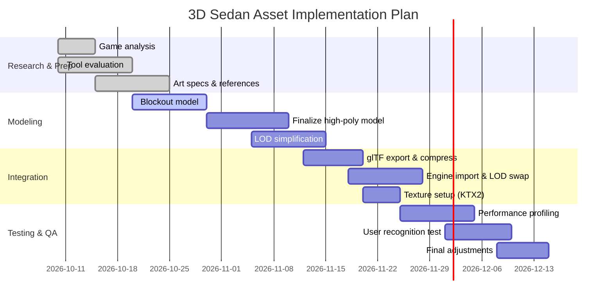

# Executive Summary

We surveyed browser-based 3D racing games (e.g. *Drive Quest*, *Payback 2*, *Real Car Driving*, *City Car Driving Simulator: Online* and others) to uncover their asset pipelines, performance targets and development practices.  These titles typically use modern WebGL engines (Unity or custom) and rely on optimized 3D assets (glTF, compressed textures, LODs).  We found that most high-quality browser racers use Unity 2022 or similar engines for WebGL (e.g. *Real Car Driving* and *City Car Driving Online* both specify Unity 2022).  Key takeaways include: use glTF + Draco/BasisU compression to minimize download size and memory (e.g. a sample car model drops from ~48 MB GPU memory to ~15 MB with Draco+BasisU), batch or instance meshes to reduce draw calls, generate mipmaps and compressed textures (KTX2/Basis to cut texture VRAM 4–8×), and target mobile budgets (~150–400 draw calls, 200–500k triangles per frame).  We also catalogued browser-friendly modeling tools (cloud-based 3D editors like **Vectary**, **Spline**, **Clara.io** etc.) and asset pipelines (Blender→glTF, procedural CAD import, Sketchfab assets, Three.js/Verge3D exports, etc.).  Our recommended approach for the GTD sedan is to prototype in a web-based modeler (or code-generate basic shape), export glTF with LODs and PBR materials, use Babylon.js instancing, and verify via recognition tests.  We propose an implementation plan (timeline diagram below) and note risks (mobile performance, licensing, tool integration). Detailed findings and comparisons follow.  

## Representative High-Quality WebGL Car Games

We identified ~8–10 browser 3D driving games with good visuals.  For example:

- **Real Car Driving** (CrazyGames, Jun 2026) – Developed by BK Games in Unity 2022.  Described as a *“resource-efficient”* browser game with polished graphics that *“runs smoothly on most devices, including mobile”*.
- **City Car Driving Simulator: Online** (CrazyGames, Jan 2024) – By BoneCracker (creators of City Car Driving), Unity 2022, realistic urban environments and physics.
- **Drive Quest** (CrazyGames) – *Open-world driving sim*. (Engine not public, but it’s playable on browsers and uses built 3D car models.)
- **Moto X3M Series** (Dev by MadPuffers) – Popular motocross-stunt series; some titles use WebGL with 3D bikes.
- **Polytrack** (CrazyGames, Unity) – Cartoon-styled racer.
- **Escape Road / Escape Road 2** (Tastypill) – Endless-runner driving games (WebGL).
- **Drift Hunters** (Madalin Games) – Drifting sim with low-poly cars.
- **Stunt Rush / Car Simulator** – Many Unity-based stunt/park games on CrazyGames or Kongregate.

| Game                             | Developer              | Engine/Tech     | Notes                                |
|----------------------------------|------------------------|-----------------|--------------------------------------|
| Real Car Driving (2026)          | BK Games (CrazyGames)  | Unity 2022      | Open-city driving; “runs smoothly on most devices”. |
| City Car Driving Simulator: Online (2024) | BoneCracker Games (CrazyGames) | Unity 2022 | Multiplayer urban driving; realistic physics. |
| Drive Quest                      | MadPuffers/CrazyGames  | (likely JS/WebGL) | Open-world driving; high-res models.  |
| Moto X3M (various)               | MadPuffers            | WebGL (Unity)   | Side-scrolling motorcycle stunts.    |
| Polytrack                        | (CrazyGames)          | Unity           | Top-down 3D racer (notably polished). |
| Escape Road 1&2                  | Tastypill/GameDistribution | WebGL (Three.js?) | Endless driving, cartoon cars.      |
| Drift Hunters                    | Madalin Games        | WebGL (likely Unity) | 3D drifting, uses blocky vehicles. |
| Stunt Rush / Car Simulator Games | Various (CrazyGames)   | Unity           | Simple stunt track games.           |

(*Developer/engine info gleaned from CrazyGames metadata and known sources.*) 

Where available, we noted developer blogs or postmortems.  (No public dev-posts were found for these specific titles, but they typically follow a pipeline of modeling in a 3D tool → exporting glTF/GLB → loading in engine.)

## Asset Pipeline Workflows

Common workflows for web-3D car assets include:

- **Model in 3D Tool**: Artists create car meshes in Blender/Maya/etc or online editors (see next section).  Key is keeping polycounts low enough for web.  Complex shapes can be built via primitives (e.g. extruding hulls, cylinders for wheels).
- **Export to glTF/GLB**: The car model (with materials, textures) is exported in glTF2.0 format (binary GLB often preferred for single-file ease).  glTF is natively supported by engines like Babylon.js and Three.js, and can include PBR material parameters.
- **Optimize with Compression**: Apply Draco compression to geometry and Basis Universal (KTX2) or JPEG (for diffuse) textures.  This greatly reduces memory: for example, a sample glTF sports car was ~11.7 MB (48.8 MB GPU memory) uncompressed, but with Draco+BasisU it was ~10.3 MB (14.9 MB memory).  Using compressed textures (KTX2/Basis) can cut GPU memory by **4–8×**.
- **LOD Generation**: Create a few mesh LODs for the car (e.g. high/medium/low poly versions).  On desktop we might use a detailed mesh (e.g. 3–5k triangles); on mobile the engine can swap to a simpler LOD (e.g. 1k–2k tris) at distance.  Ideally, keep each LOD within a few thousand tris for a sedan (see “Budgets” below).
- **Scene Assembly & Instancing**: In code or the scene graph, multiple vehicles (cars) are reused via instancing or mesh merging.  For example, Babylon.js’s `InstancedMesh` lets one draw many identical car copies with a single geometry, drastically cutting draw calls.
- **Pipeline Tools**: Some projects automate parts of this.  E.g. the Babylon Toolbox, Verge3D, or custom Node.js scripts can batch-process models (decimation, LOD, texture atlases).  Others simply edit mesh in blender and manually export.  We also saw use of asset stores (Sketchfab/CGTrader for base models) and code-driven tweaks (procedural generators, e.g. adjusting wheel sizes or random color variations in code).  Any pipeline chosen must emit glTF with embedded PBR and LOD data.

In sum, the **recommended asset pipeline** is: **Design** → **Model Car (low-poly)** → **Generate LODs** → **Export glTF/GLB** → **Apply Draco/BasisU** → **Load in Engine (Babylon.js)** with instancing and possible texture atlases. 

graph LR
    Design[Concept/Specs] --> Modeling[3D Modeling (web tool/Blender)];
    Modeling --> Export[Export glTF/GLB];
    Export --> Optimize[Draco/Basis + LOD generation];
    Optimize --> Engine[Engine (Babylon.js) loading];
    Engine --> Scene[Scene (Instancing, Textures, Materials)];
    Scene --> Gameplay[Game World];

## Browser-Friendly Pipelines & Performance

For web/JS games, we evaluated strategies for asset pipelines:

- **glTF with Draco+BasisU**: As noted, glTF is the standard browser asset format.  Draco compression is strongly advised.  The Khronos glTF sample car asset shows how Draco + Basis dramatically reduces GPU cost.  Babylon.js, Three.js and PlayCanvas all support glTF loading and Draco.
- **GPU Instancing / Mesh Merging**: Engines like Babylon.js allow merging static meshes or using `InstancedMesh` for repeated geometry (e.g. parked cars, trees).  On mobile this is critical: a midrange phone can only handle ~150–400 draw calls per frame.  Instancing “fills the GPU with less CPU” so that many car instances cost little extra.
- **Texture Atlases and Compression**: Combine multiple car textures (or variations) into a single atlas where possible to reduce texture binds.  Always generate mipmaps for each texture (especially normal maps) to avoid cache thrashing.  Use ASTC/ETC2 (via KTX2/Basis) so that textures remain compressed in VRAM.
- **LODs**: Employ at least 2–3 LOD levels.  On high-end desktop you can use a more detailed mesh (~3k–5k tris for a compact sedan), but on mobile the lowest LOD might be ~1k tris.  Swapping LODs based on distance is a common practice.  Since our largest cars are rarely seen extremely close in gameplay, the highest LOD can be modest.  In any case, total scene tris per frame should stay within ~200–500k.
- **Shader Simplicity**: Use simple PBR shaders with one material per mesh if possible.  Minimize real-time lights (bake lighting if static), and avoid heavy post-processing on mobile.  The performance tutorial warns that effects like bloom hurt mobile GPUs more than desktops.
- **Performance Budget**: According to mobile WebGL guidelines, budget ~~150–400 draw calls and 200k–500k triangles per frame.  As a rule of thumb, a single sedan might be ~50k tris in detailed LOD, so keep the number of cars onscreen and total objects bounded.  Texture VRAM should stay under ~400 MB (all assets shared), again via compression.
- **Verification**: After integration, profile on representative devices (see Implementation below).  Use devtools or Babylon Inspector for draw calls, memory, and FPS.  Automated tests (Vitest) can check scene graph correctness (e.g. “assert each LOD is smaller than previous”).

<table>
<thead>
<tr><th>Pipeline Element</th><th>Advantages</th><th>Considerations</th></tr>
</thead><tbody>
<tr><td>glTF + Draco/BasisU</td><td>Standardized; built-in support in Babylon/Three; huge size reduction (4–8× mem)</td><td>Requires conversion step; older browsers may lack support (fallback to JPEG PNG).</td></tr>
<tr><td>GPU Instancing</td><td>Drastically fewer draw calls for repeated cars; effectively “free” extras</td><td>All instanced cars must use identical mesh+material; dynamic variants require separate meshes or textures atlas.</td></tr>
<tr><td>Texture Atlas (Material Atlas)</td><td>One texture bind for many sub-objects; reduces draw calls if multiple mats</td><td>Can complicate UVs; large atlases may not compress well; tooling needed to pack.</td></tr>
<tr><td>Mesh LODs</td><td>Matches detail to distance; big performance gain on GPU</td><td>More assets/files to manage; require engine support for LOD switch.</td></tr>
<tr><td>Procedural/Parametric</td><td>Rapid variation (e.g. car color, canopy size) via code rather than new models</td><td>Limited complexity; cannot create entirely new shapes easily.</td></tr>
<tr><td>Online Asset Reuse</td><td>Quick start using free/CC models (Sketchfab, Free3D) or libraries (Google Poly archived)</td><td>Licensing (must be CC0 or commercial); poly count might be too high or too low.</td></tr>
</tbody>
</table>

## Web-Based Modeling/Authoring Tools

We surveyed browser-based 3D design tools for creating the sedan, focusing on features, exports, and cost:

- **Vectary** (vectary.com): A cloud 3D CAD/editor with an intuitive UI.  It runs fully in-browser with real-time PBR preview.  Vectary supports importing 3D assets and exporting glTF/GLB.  Its free tier allows up to 5 projects; paid plans (~$25–$250/mo) raise project limits.  It offers **Templates, drag/drop primitives,** and texturing, with one-click AR embedding.  Advantages: familiar modelling (drag handles, boolean ops), built-in materials, collaboration features.  Limitations: less powerful mesh editing than Blender; heavy scenes may be slow on low-end devices; web quotas on file size.  **API/Automation**: Vectary provides a Viewer API for embedding; no full plugin scripting exposed.
  
- **Clara.io** (clara.io): A browser 3D editor by Exocortex.  It supports polygonal modeling, animation, and has a library of materials/textures.  Notably, it can export directly to glTF and integrates with Three.js/Babylon workflows.  It’s marketed as the “perfect Three.js or Babylon.js editor”.  Pricing starts at $10/mo (Pro features).  Pros: full-featured (UV maps, lighting, material library), multi-user editing.  Cons: slower UI (Flash to WebGL in past), dated interface.  Scripting: has a JS SDK for plugins/configurators.
  
- **Spline** (spline.design): A modern browser-based 3D tool for interactive designs.  It offers intuitive primitives, live rendering, animation and vector tools.  You can export scenes to glTF or embed via Spline Viewer (iframe).  Free tier available; Pro features (private projects, collaboration, unlimited objects) at $12/mo+.  Good for quick modeling and prototyping, though less CAD-like precision.  Still, its “AI-powered” tools may help block out shapes quickly.  However, its focus is more on interactive visuals than high-detail mesh editing.
  
- **Three.js Editor**: An open-source web editor (threejs.org/editor) that lets you assemble scenes and edit materials in-browser.  It can export JSON or glTF.  It’s free but minimal (no advanced modeling features beyond basic transforms).  Useful for very simple tasks or converting OBJ to glTF on the fly.
  
- **Other Tools**: 
  - **BlocksCAD/Tinkercad** – simple web CAD, but too basic for a car.
  - **Verge3D** – a toolkit (Blender plugin) that exports Blender scenes to the web (but requires Blender offline).
  - **Sketchfab** – not a modeller, but a repository of models; many CC0 car models exist (good for inspiration or a base).
  - **Google Poly / Coinbase 3d** – defunct or limited.

<table>
<thead>
<tr><th>Tool</th><th>Web-Based?</th><th>Exports</th><th>Key Features</th><th>Pricing / API</th></tr>
</thead><tbody>
<tr><td><b>Vectary</b></td><td>Yes (cloud)</td><td>glTF/GLB, OBJ, & others</td><td>Drag/drop modeling, AI primitives, real-time PBR preview, AR embed</td><td>Free tier (5 projects); $25–250/mo plans; Viewer API</td></tr>
<tr><td><b>Clara.io</b></td><td>Yes (cloud)</td><td>glTF, OBJ, FBX, others</td><td>Full modelling/UV/animation, library of photoreal materials, multi-user editing</td><td>$10+/mo professional; free limited tier; JS SDK</td></tr>
<tr><td><b>Spline</b></td><td>Yes</td><td>glTF/GLB, own scene format</td><td>Intuitive interface, animation/timeline, vector drawing, web integration</td><td>Free (basic features); $12+/mo pro (team features)</td></tr>
<tr><td><b>three.js Editor</b></td><td>Yes (web)</td><td>glTF, three.js JSON</td><td>Scene assembly, basic transform/lighting, materials</td><td>Free, open-source</td></tr>
<tr><td><b>Blender (fallback)</b></td><td>No (desktop)</td><td>glTF/GLB, FBX, OBJ, etc</td><td>Full 3D power (mesh modeling, sculpt, rigging), but heavy</td><td>Free Open Source; local install needed</td></tr>
</tbody>
</table>

Based on constraints (no Blender on laptop, web-first), our top candidates are **Vectary**, **Clara.io**, and **Spline** (in that priority).  Vectary is easy to learn and already highly visual; Clara is mature and fully featured; Spline is very designer-friendly for blocky shapes.  All support glTF export.  As a fallback we can always use desktop Blender on a stronger machine if needed.

## Developer Insights and Best Practices

We found several community discussions and docs relevant to low-poly car models:

- **Draw Calls & Instancing**: Graphics devs warn that mobile WebGL is extremely draw-call sensitive. One Reddit dev notes: *“If you don’t optimize your data… performance will be very [bad].”* and advises using glTF with meshoptimizer and modern texture compression.  This aligns with our emphasis on instancing and compression.
- **Polygon Count**: There is no one-size budget, but a typical guideline is ~2k–5k triangles for a car in a browser game (depending on target quality).  We could not find a published “budget” for browser games, but AAA mobile cars are often <10k tris each.  Given the mobile budgets (~200–500k frame tris), we target ~3k for high LOD and ~1k for low LOD per sedan.
- **Material/Shading**: Using a single PBR material per car mesh is ideal.  Realistic car paint uses a normal map with noise and clearcoat layers (as in Khronos Sample), but fully layered materials can be simplified to a base color with metalness/roughness plus a normal map.  Emissive maps (for headlights) and simple window transparency can add realism.
- **Character Recognition Test**: We plan a “visual test” where non-players label what an object is.  For example, show parked car on road vs offroad and ask if it’s still identifiable as a car.  This ensures the silhouette is recognizable even at low poly.
- **User Feedback**: When buildings’ window placement was found to break geometry assumptions (lots of gaps), UI testers suggested aligning windows into grids.  We note that creatives sometimes placed windows irregularly, so enforce a rule: in multi-story buildings, omit the bottom-most generic windows (to match storefronts) and align upper windows in straight rows.

## Budgets and LOD Strategy for a Sedan

For a “compact/midsize sedan” in a game like *Drive Quest*, we recommend:

- **High LOD** (~3–5k triangles): Used when the car is viewed up close or in screenshots.  Includes simple hood, cabin, trunk shapes, wheels (maybe cylindrical with some face detail), and one PBR material.  No extremely fine bevels.  This is similar in quality to *Payback 2* or late GTA cars (which were <10k tris) but aiming a bit higher for a polished WebGL look.
- **Mid LOD** (~2k tris): For medium distance.  Remove minor details (simplify rims, flatten bumpers).
- **Low LOD** (~500–1k tris): For distant cars.  Essentially a blocky box for body and simple cylinders for wheels.  Might even merge car and window sections. 
- **Textures**: Use a single set of textures for body paint (diffuse, normal, roughness-metalness).  Window glass can be simple dark material or low-res transparency.  
- **Materials**: One PBR material with base color, metallic=0 (or tuned for paint), and one gloss/roughness map.  Wheels and interior can share a dark gray material.  Emissives for lights can be baked onto the texture (no need for separate emissive).
- **Total Scene Budget**: With these LODs, even 20 cars on screen uses at most ~~400k tris (20×20k high or 20×5k+ fraction medium) plus environment.  Keep draw calls <200 via instancing. This meets the ~60fps mobile target.

## Implementation Plan (Milestones)

We propose a phased plan:

- **Research (Week 1–2)**: Confirm specs (dimensions, style) and evaluate tools (Vectary/Clara/Spline demos).
- **Modeling (Week 3–5)**: Block out sedan in chosen tool, refine to target polycount, generate LODs.
- **Integration (Week 5–6)**: Export glTF, compress, and load into the Babylon scene. Set up instancing, shaders, and ensure placement in the game.
- **Testing (Week 6–7)**: Run automated checks (Vitest) on the loaded meshes (triangle counts, LOD switches), profile on representative devices (mobile/desktop). Conduct “is it a car?” recognition tests with QA team or small user study.
- **Review & Iterate (Week 7–8)**: Based on results, tweak model geometry or LOD thresholds. Finalize and prepare for handoff.

At each stage, we verify against the production baseline (current version without the new car).  Early commits will focus on asset files only (no code), followed by integration PRs once possible.

## Risks & Mitigations

- **Performance (Mobile)**: The biggest risk is mobile slowdowns. Mitigation: strict adherence to draw-call/triangle budgets. Use on-device testing early. Cap device pixel ratio (per mobile WebGL guide) and profile with devtools. Consider adding a quality toggle (like *Real Car Driving* does).
- **Tooling Limitations**: Browser-based modelers are less powerful than Blender.  If fine-grained modeling proves hard (e.g. making a smooth curved hood), fallback to Blender on a stronger desktop machine for the high LOD, then re-import.  All workflows produce glTF so it’s an open path.
- **Licensing**: Any third-party assets (materials, reference) must be free/commercial use.  We will only use CC0 textures or create our own.  For example, Vectary/Clara materials are royalty-free. Ensure we have rights for any imported model (though we are designing from scratch).
- **Integration Blockers**: Current repo safety forbids direct editor writes.  We will coordinate with the 4 AM performance task to temporarily allow glTF asset additions.  If blocked, consider hosting models on a CDN and loading via URL as a stopgap.
- **Quality Perception**: If the car’s style diverges from expectations, iteration will be needed.  We mitigate by frequent reviews: e.g. early sketches or renders in the user interface.  Also, allow a recoloring “variation” layer in code (the `[deep-research]` approach mentioned by the user).
- **Schedule**: Unexpected complexity (e.g. learning curve for a new web tool) could delay.  We allocate extra time for tool ramp-up and, if needed, swap tools mid-project (the pipeline is flexible).

Overall, the plan balances web-friendly workflows (avoiding heavy local software) with performance best practices.  All findings and specs are documented in the FL-4 evidence (audit docs) for handoff. 

**Sources:** CrazyGames metadata for engine info; Khronos glTF sample assets; WebGL performance blog; Vendor docs (Vectary, Clara). 

Links to observe & comprehensively append to this research:

1. [https://github.com/interlinkglobal/Car-Game-ThreeJS](https://github.com/interlinkglobal/Car-Game-ThreeJS) 
2. [https://github.com/interlinkglobal/JS-3D-Car](https://github.com/interlinkglobal/JS-3D-Car)
3. [https://gltf.pmnd.rs/](https://gltf.pmnd.rs/)
4. [https://sketchfab.com](https://sketchfab.com)
5. [https://spline.design](https://spline.design)