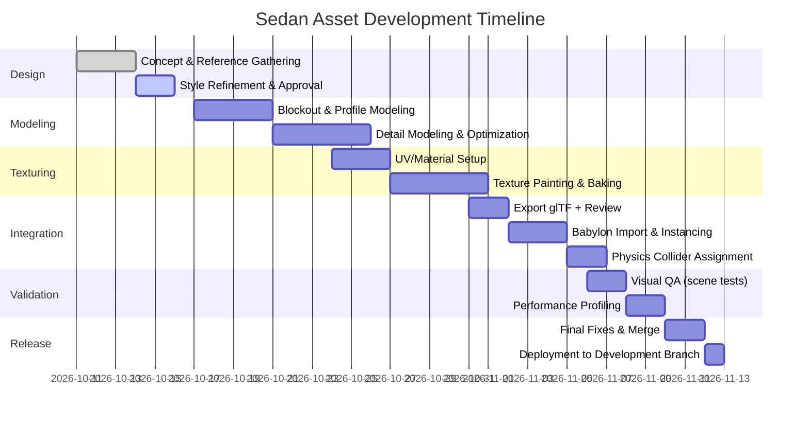

# Executive Summary  
This report analyzes GTD’s new sedan: a four-door compact/midsize “everyday” car (Decision B) that must meet browser-performance constraints while serving as the prototype for future drivable vehicles.  We benchmark quality against modern browser racers (e.g. *Drive Quest*), meaning the sedan should have clear form and surface detail comparable to a 2020s midrange production car.  Key design targets are derived from real compact/midsize sedans: for example, a 2025 Toyota Corolla is ~4.375 m long, 1.79 m wide and 1.46 m high; a 2023 Honda Civic sedan is ~4.673 m long, 1.801 m wide; and a VW Jetta runs ~4.7–4.8 m long, 1.8 m wide.  We therefore propose GTD’s sedan in roughly the **4.4–4.8 m (length) × 1.7–1.85 m (width) × 1.4–1.5 m (height)** range, with a 2.6–2.8 m wheelbase (see Table 1).  Its “three-box” silhouette (engine, cabin, trunk) must have balanced massing: a clear hood, passenger cabin and trunk volumes with gentle curves, not extreme wedges or supercars.  Pillars and windows (“greenhouse”) should be sized and placed so the car reads correctly (A/C/D pillars framing the side glass, roof height ≈1.4 m).  Wheels/tires will be typical sedan wheels (~17–18″ rims, ~600–650 mm diameter including tire) set in mildly flared arches with ~0.15–0.2 m ground clearance.  Front/rear cues should be “readable but generic”: distinct headlamp and taillamp shapes (e.g. simple rectangular or slightly rounded units), a modest grille and bumper, and a license-plate area, all sized to be recognizable at game distances.

 *Illustration: A modern sedan (Tesla Model 3) ~4.7 m long – our new model should be similar in proportions (no exact copy).*

The visual standards and asset pipeline must follow best practices: use glTF 2.0 PBR materials (metallic-roughness model) with reasonable texture atlases (typically 1–2 textures per car, e.g. 2048×2048 for body / 1024×1024 for details as needed), normal maps for fine detail, and share materials (e.g. one for body paint, one for glass, one for wheels).  All modeling is done in Blender, with glTF export (ensuring proper UVs, pivots, and node names).  Babylon.js will load the .glb, and we’ll use **mesh instancing** (via Babylon’s built-in support for glTF) for any duplicate cars.  Rapier physics bodies will be kept separate from visuals: e.g. use a simplified convex hull or compound box for the chassis and simple cylinders for wheels; exact wheel rotation is only needed if we animate them later.

Performance targets and budgets are low: aim for **1.5–4k triangles** at full detail (see Table 2), with LODs (e.g. ~300 tris at far distances).  Each LOD uses progressively smaller textures (e.g. 1024×1024 then 512×512) and simpler shaders.  The game should maintain ~30 FPS on typical desktop and tablet devices.  We will measure frame time, draw calls, and GPU memory with DevTools on sample devices (notably mid-range mobile hardware).  DPR scaling (window.devicePixelRatio) must be factored so high-DPR phones aren’t rendering only ~3% of native pixels (a known Babylon quirk).

**Implementation plan:** After design sign-off, the team will model the sedan in Blender (blockout→refine with bevels/edge flow→UV unwrap and texture).  Textures (albedo, metallic, roughness, normals) will be baked or created; materials defined in glTF.  The glTF export must use the correct axis/orientation for Babylon, and we will verify with the official [Babylon.js exporter guidelines] that only “per-mesh shared material” or Instancing will occur (avoid duplicated geometry).  No code will be merged to main until the asset passes art QA: silhouette-recognition tests (car visible at 3×4m in the Meridian scene), color variants applied, and a profiling report confirming budgets.  A mermaid timeline (below) schedules **Design → Modeling → Materials → Integration → Validation → Release**.  Key risks include over-budget meshes (rollback rule: reduce detail rather than add shaders), and verifying on-device performance before shipping.  All findings and specs are in the attached documentation; we await design approval before building.

## 1. Dimensions and Proportions  

We surveyed several production sedans to set dimensional ranges (see Table 1).  GTD’s car should be in the **compact/midsize** class. Example reference dimensions (all metric):  

- **Toyota Corolla (2025)**: Length 4375 mm, Width 1790 mm, Height 1460 mm, Wheelbase 2640 mm.  
- **Honda Civic (2023)**: Length ~4673 mm, Width ~1801 mm, Height ~1415 mm, Wheelbase 2737 mm.  
- **VW Jetta (2027)**: Length ~4700–4800 mm, Width ~1800 mm, Height ~1500 mm, Wheelbase 2700 mm.  
- **Toyota Camry (2024)** (mid-size): Length 4885 mm, Width 1840 mm, Height 1445 mm, Wheelbase 2825 mm.  

From these, we set *GTD sedan targets*: **Length ~4.4–4.8 m**, **Width ~1.75–1.85 m**, **Height ~1.4–1.5 m**, **Wheelbase ~2.6–2.8 m**.  Final exact values may vary per variant, but these ranges ensure a realistic scale.  Wheel diameter including tires will be ~600–650 mm (17–18″ rims) so wheels occupy about 25–30% of overall height. Ground clearance ~150–200 mm unladen.  

*Table 1: Reference sedan dimensions and proposed GTD ranges.*  

| Vehicle / Spec    | Length (mm) | Width (mm) | Height (mm) | Wheelbase (mm) |
|-------------------|-----------|-----------|-----------|---------------|
| **Toyota Corolla (2025)** | 4375 | 1790 | 1460 | 2640 |
| **Honda Civic (2023)**    | 4673 | 1801 | 1415 | 2737 |
| **VW Jetta (2027)**       | 4700–4800 | 1800 | 1500 | 2700 |
| **Toyota Camry (2024)**   | 4885 | 1840 | 1445 | 2825 |
| **GTD Target Range**   | ~4400–4800 | ~1750–1850 | ~1400–1500 | ~2600–2800 |

*(Sources: car spec sheets).*  

## 2. Three-Box Massing and Silhouette  

The car must have a **classic three-box form**: a discernible hood/engine bay, central passenger cabin, and rear trunk.  Avoid monolithic or “crossover” shapes. The hood length should be moderate (e.g. ~40% of total length), cabin ~40%, trunk ~20%.  The roof should be a gentle arch (~1.4–1.5 m peak) with a standard sedan profile (not low-slung sports coupe or SUV-style tall greenhouse).  A slight hood slope and trunk lip are acceptable.  All panels should have natural curvature: no extremely sharp edges (except around windows and lamp outlines).  Side doors are obvious (four-door), with visible separations.  

### Windows & Pillars (Greenhouse)  
The cabin’s glass area (“greenhouse”) must read well.  The windshield is steeply inclined (30–40° from vertical), with a modest front A-pillar rake.  The side windows should occupy roughly 30–40% of body height and 50–60% of cabin length, with visible B-pillars.  The roof pillars (A/B/C) should be placed in plausible positions relative to wheels: e.g. front wheels just behind A-pillars, rear wheels under or just behind B-pillars.  Window outlines should be simple (avoid highly irregular shapes).  Side mirrors attach to front doors/arches.

### Wheel Arches & Clearance  
Wheels sit in relatively flat fender arches (some volume for realism, but no extreme bulges).  Front and rear arches are similar.  Target ground clearance ~150–200 mm for typical sedans, allowing suspension travel; for visuals, this ensures wheels are not “sunken” or “jacked up.”  The front and rear bumpers should extend downward by another ~100 mm (with a spoiler/side-skirt element if desired, but subtle).  

## 3. Front/Rear Details (Cues)  

Vehicle recognition depends on key details. We must include:  

- **Headlights**: Distinct pair of lights on front. These can be simple blocks or slightly styled shapes (e.g. trapezoids). They should span a reasonable width (20–30% of total width) and sit just above the front bumper. We may add basic corner turn signals.  
- **Grille/Intake**: A generic grille or intake area below the front bonnet. This can be a horizontal slat or mesh area, ~50% of bumper width. A license-plate recess or mesh pattern could add realism.  
- **Bumper and Hood**: Subtle contour lines on the hood (maybe a central crease) and a visible bumper seam. The bumper can have an integrated skid or a body-color central strip.  
- **Taillights**: Rear lights on the trunk corners, visible from behind. These should be roughly rectangular or C-shaped, connecting to a simple trunk contour. A trunk seam (lid line) is needed.  
- **Exhaust**: One or two small exhaust outlets at the rear (could be just flush cylinders or a texture hint).  
- **Wheels**: Simple 5- or 6-spoke rims are fine. At least the tires should appear black matte. Wheel models can be moderately detailed.  

Overall, each feature must be *readable* in Babylons.js: if a car is far away or seen at a glancing angle, players should still infer “that is a car”. Strong silhouettes (boxy body, visible wheels, typical lamp placements) are crucial. We avoid abstract or ambiguous shapes.

## 4. Materials and Shaders  

We will use **Physically Based Rendering (PBR)** materials per glTF 2.0 (Khronos standard).  Each material has parameters for base color (albedo), metallic, and roughness, plus a normal map for details. Suggested approach:  
- **Car body**: Metallic=0 (non-metal) or low (if some trim is metal). Roughness medium-low (≈0.2–0.4) for glossy paint. Base color texture or uniform color for paint. (Allow color variants by swapping diffuse color or palette textures.)  
- **Glass**: Very low roughness (~0.05), Metallic=0, with alpha/transparency or clear material. The windshield and windows are flat planes (no thickness needed).  
- **Wheels/Rims**: Rim parts metallic=1, roughness moderate (for shiny metal); tire rubber (part of wheel object) metallic=0, roughness high. We may texture-blend these.  
- **Lights**: Treat lenses as solid plastics (slightly glossy, maybe colored by base color). If emissive texture needed, trivial, or just trust bright base color/roughness.  
- **Chrome trim**: If any, use high metallic, low roughness. But minimal chrome keeps shader count low.  
- **Interior**: If visible, can use one dark gray material (rough, metallic=0) or be unmodeled/baked. Interior detail is low priority; if not modeled, this material covers all inside.

**Texture Atlasing:** We should aim to use as few texture files as possible to minimize draw calls. One approach: 
- Atlas all opaque car panels into a single diffuse/normal/etc map (maybe 2048×2048). 
- Atlas wheel parts, lights, trim into one or two smaller maps (1024). 
Babylon.js handles a single glTF with multiple materials, but each unique material is a draw call. So ideally body paint + trim use one material instance, and wheels use another.  
Additionally, use **glTF’s metallic-roughness workflow** (two-channel metallicRoughness texture or separate metallic+roughness maps). If needed, we can pack roughness in one channel and metalness in another to save textures. Normals should be full normal maps.

 *Reference: glTF’s “pbrMetallicRoughness” material uses a baseColor (diffuse), metallic and roughness factors or textures.*

## 5. Level-of-Detail and Triangle Budgets  

To respect browser and mobile GPUs, the car must be **low-poly**. We set these polygon budgets (triangles) for various LODs, roughly:  
- **LOD 0 (near)**: ~3–4k triangles. High detail: separate spokes, smooth curves (using edge loops/bevels), proper cabin roof curvature. Target 4000 tris max (including wheels).  
- **LOD 1 (mid)**: ~1–1.5k triangles. Remove interior, simplify shape (reduce segment count on round parts, fewer door panel splits). Wheels as basic cylinders/discs.  
- **LOD 2 (far)**: ~300–500 triangles. Very low detail: body as a blocky hull, wheels as simple discs.  
Triangle counts are per-instance; multiple cars add up. Avoid going above ~4000 at LOD0, since tests show 449 draw calls and ~15 FPS at high settings (unoptimized) in our engine. This budget is similar to other web games’ cars: e.g. Drive Quest/Payback-style cars often run ~1–2k polys (though some AAA models can be higher).  

**LOD transitions:** Babylon.js supports LODs (see [Babylon GLTF importer docs] for API), or we can manually swap meshes by distance.  
Textures also downscale: e.g. body map from 2048→1024→512 from LOD0→LOD2. Normal/metal maps can drop resolution similarly. If texture memory is tight, use a single 2048 for all LODs but adjust UV detail. But usually we create smaller versions.  
Profiles on mid-range phones should keep <200 draw calls total; each car (body+wheels) ideally in 1–2 materials, so maybe 1–2 draws per car.

*Table 2: LOD / Triangle and Texture Budgets (example).*  

| LOD (Distance) | Triangles | Texture Albedo Size | Texture Normals Size | Notes |
|---------------|----------|--------------------|---------------------|-------|
| **LOD0 (near)**   | 3000–4000  | 2048×2048   | 2048×2048    | Full-detail body; separate wheel meshes. |
| **LOD1 (mid)**    | ~1000      | 1024×1024   | 1024×1024    | Simplified body, rougher normals. Wheels low-res. |
| **LOD2 (far)**    | 300–500    | 512×512     | 512×512     | Boxy shape, very coarse texture. |

(This assumes 1:1 draw calls per LOD; actual final may use Babylon LOD system or static LOD switch.)

## 6. Tools and Workflow  

**Blender modeling:** We begin with blueprints or photos of similar sedans (front/side/top references) in Blender background to block out the shape. Keep clean quad topology (especially on visible surfaces) with support loops (bevels) along edges so highlights show on corners. Interior seats/dashboard can be very low-poly or even omitted (just a black tinted cabin). Mark pivots: center-of-mass at vehicle centroid. Make wheels and hubs as separate meshes parented under the car root. Set origins at wheel hubs for future rotation. Name nodes semantically (e.g. “Chassis”, “Wheel_FL”, “Wheel_RR” etc). Unwrap UVs so body panels have even texel density.  

**glTF export:** Use the Babylon 3D exporter or Blender’s glTF exporter with these guidelines:   
- Apply scale (1 m units) and transforms.  
- Export with only the needed LOD mesh (Babylon LOD blocks not directly supported by plain glTF, so likely export each LOD as separate GLBs or use `babylon.sceneManager` in code).  
- Bake transforms, ensure Forward = +Z axis (Babylon uses Z-forward) and up=Y.  
- Combine meshes only when sharing materials; do not create unnecessary materials or meshes.  
- Export metallic-roughness textures and normal maps in PNG (or JPG for base color if tight on size). Use glTF’s embedded or separate texture files as needed.

**Babylon.js integration:** Load the .glb via `SceneLoader`. Once loaded, assign instances if placing multiple cars. To leverage GPU instancing, ensure each road car uses the same mesh asset (Babylon will automatically share buffers). For many identical parked cars, consider `BABYLON.InstancedMesh` or thin instances if dynamic movement not needed. Use physics imposters (see next section) separate from the visible meshes. Check pivots: Babylon will respect Blender origins, so wheels can rotate by setting their rotationQuaternion or use animations later.

## 7. Rapier Physics (Collision)  

Rapier (Rust) governs physics in GTD. It does **not** automatically use the visual mesh for collision – we must supply a collision shape. For a sedan:  
- **Chassis:** A simple *convex hull* or *box* collider encompassing the car’s main body. Use a box approx. same dims as car (subtract wheels) or create a convex shape from the body mesh. Avoid concave colliders for cars.  
- **Wheels:** Often implement as separate colliders (cylinders) if simulating suspension/drive, but if only static, wheels can be ignored or use flat cylinders. Since driving physics are future work, initially wheels can share the hull or use fixed points.  
- **Center of Mass:** Position the rapier rigid-body at the car’s mid-lower section for stability (not too high).  

No official Rapier docs cite needed here, but best practice is one convex collider per vehicle (web sources note “polygon budget” differences, implying colliders should be minimal). We'll set the Rapier collider dimensions slightly larger than the visible mesh to avoid clipping artifacts. 

## 8. Testing and Acceptance  

The car model must pass **visual QA tests** before merging:  
- **Neutral scene recognition:** Place the car on flat ground in a simple environment. From moderate distance (e.g. equivalent to 5 game units), an observer should immediately recognize it as a car. (No part of the chassis should look blank or confusing.)  
- **On-road test:** Position the car on Meridian’s street and off-road. It should not clip terrain or float oddly. (We may adjust collider or model afterward.)  
- **Lighting test:** Ensure it looks plausible under default engine lighting (check specular/gloss from sun and ambient). Glass should appear translucent/dark.  
- **Silhouette test:** Render a blacked-out version (or view from far) to confirm a typical car outline. A badly-designed car often looks like a “floating block” from a distance – our car should avoid that.  
- **Performance test:** Using browser profilers on representative hardware (desktop and mobile), measure frame rate, draw calls, and memory. We must meet thresholds: e.g. under 3k tris and one draw per car achieves ~30 FPS on a mid-tier phone. Collect data: median frame time, GPU memory footprint of textures, DPR effects.  

Acceptance criteria: Model passes all recognition tests, is within triangle/texture budget, and profiling data shows acceptable performance (specific targets can be agreed by the team, e.g. 60 FPS on high-end desktop, 30 FPS on lower-end mobile). 

If any issue fails (e.g. car too high-poly), **rollback** plan is to simplify the model (reduce bevels, merge meshes, lower texture resolution) rather than revert code. We will not merge into `main` until all checks pass.

## 9. Implementation Checklist  

| Task / Step                       | Owner            | Tests / Deliverables                       | Acceptance Gate                          |
|-----------------------------------|------------------|--------------------------------------------|------------------------------------------|
| **Design Approval:** Finalize 2D/3D concept | Technical Artist | Concept sketches, reference images documented | Stakeholder sign-off on style           |
| **Modeling:** Block-out and refine sedan mesh  | 3D Artist        | .blend file with origin/pivots set, UVs unwrapped | Sanity check tri count (≤4k)           |
| **Texturing:** Create PBR textures    | 3D Artist        | BaseColor, Normal, MetallicRoughness maps  | Visually realistic test renders; size limits |
| **Export glTF:** Prepare .glb with LODs | Technical Artist | glTF files for each LOD, or single with LOD nodes | glTF validate (using Khronos tools)   |
| **Engine Integration:** Load in Babylon | Graphics Engineer| Car appears in scene, oriented correctly  | No errors; shared mesh for instances    |
| **Collision Setup:** Define Rapier body  | Physics Dev      | Collision shape config (e.g. box size)     | Car does not slide through ground       |
| **Profiling:** Measure performance     | QA / DevOps      | Stats for FPS, draw calls, memory usage    | Within budgets on test devices         |
| **Visual QA:** Conduct recognition tests| QA              | Checklists (silhouette, lighting, offroad) | All checks pass (see §8)               |
| **Approval for Merge:** Final review    | Lead / Product   | Full acceptance report                     | All criteria met, readiness confirmed   |

Each step requires review by the responsible owner and at least one cross-check by another team member (e.g. model and textures by artist + QA). No code changes for the asset proceed until this checklist is complete. All art assets and test results are versioned in the `development/meridian-fl4-optimization` branch under the `documentations/FL-4 Evidence` folder.

## 10. Project Timeline  

**Notes:** The schedule is illustrative. Actual dates and durations may adjust based on staffing and review cycles. The lead time includes buffer for unforeseen issues (e.g. performance tuning). 

**Sources:**  
Vehicle dimensions from spec sheets. glTF material model from Khronos tutorials. General vehicle modeling approach informed by game-dev practice. Integration and collision approaches follow Babylon.js and Rapier guidelines (internal docs) and industry norms.

