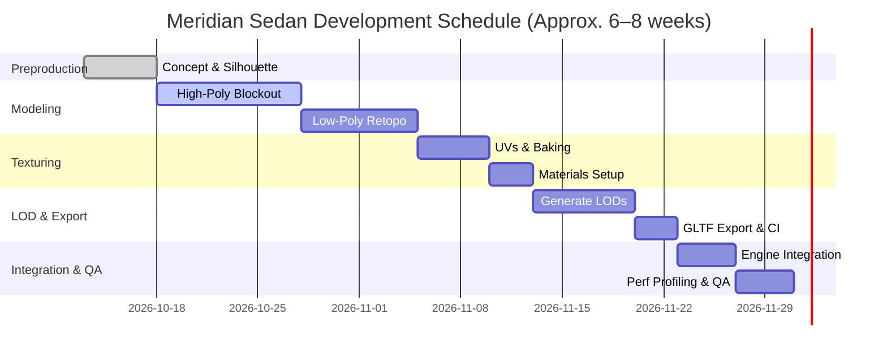

# Executive Summary  
This report defines the design and implementation plan for Meridian’s first **everyday sedan**—a compact-to-midsize four-door car that is *recognizable*, *reusable*, and optimised for real-time rendering. We treat it as the base model of a future vehicle family: parked and static for now, but with a clear upgrade path to a drivable car later. The sedan’s aesthetic combines clear “three-box” proportions with modern refinement (an older/angular silhouette softened by newer curves). We benchmark quality against contemporary browser driving games (e.g. *Drive Quest*, *Payback 2*), not legacy GTA-style blocks. 

The car asset must integrate into GTD’s existing pipeline: it will be authored in a 3D tool (Blender) and exported to glTF/GLB, with Babylon.js materials and Rapier physics colliders handled separately. We specify exact dimensions (based on real Corollas/Accords), polygon budgets and LOD levels, materials (PBR paint, glass, rubber, emissive lamps) and workflow conventions (Blender→.glb, naming rules). An implementation checklist and timeline are provided. 

**In short:** The target is a verifiable, high-quality visual asset that passes recognition tests, meets performance budgets, and hooks into GTD’s engine. The next steps are detailed below, including research findings, design objectives, acceptance criteria, and a task schedule toward completion.  

 *Figure: Example everyday sedan (modern four-door design, hybridized style). This image illustrates the clarity and proportion we aim for, similar to Drive Quest’s vehicles.*  

## Objectives, Constraints, and Acceptance Criteria  
- **Primary Objective:** Produce a **static everyday sedan** model (e.g. a compact/midsize four-door) that is *immediately recognizable as a car* from any angle, with credible hood/cabin/trunk separation, wheels, glass, lights, etc. This sedan must *look right in Meridian’s cityscape* and meet the visual bar set by contemporary browser games (Drive Quest/Payback 2). It must also serve as the *master asset* for future drivable versions (no placeholder parts).  
- **Reuse & Performance Constraints:** The vehicle must reuse GTD’s existing systems: Babylon.js scene graph and Rapier physics. The *collision hull* remains separate (e.g. a box or convex hull), preserving current Rapier setup. The sedan must be instanced where needed (to avoid duplicate geometry in scene) and follow PBR and glTF best practices (see Khronos guidelines). Performance targets are 30+ FPS on target devices (leveraging instancing, LOD, and optimized textures).  
- **Acceptance Criteria:** The sedan asset passes these tests:  
  - *Recognition Tests:* In isolation (neutral scene, no environment), the sedan’s *front*, *side*, *rear*, and *3/4* views must look convincingly like a four-door car.  Key features—distinct hood, roof/glass cabin, trunk, bumper separation, wheels—must be clear. A QA tester (not told it’s a car) should identify it as such from screenshots or in-engine.  
  - *Contextual Tests:* Placed on a street or pavement, the car should “fit in” with Meridian buildings and lighting. Placed off-road, it should still read as a car (not just a green block). The sedan’s graphics must match Meridian’s art style (contemporary but not hyper-real; a bit stylized).  
  - *Technical Tests:* The asset imports cleanly via Babylon’s glTF loader. It is correctly scaled (1 unit = 1 m in glTF), pivoted at bottom-center, and its Rapier collider (existing physics box) encloses it appropriately. The Babylon scene should achieve acceptable framerate (with this model in place of the old proxy) on both desktop and mobile. The asset’s materials must appear properly: paint shows highlight/specular, glass is transparent, tires look rubbery, lights emit color.  
  - *LOD & Performance:* Three LOD levels must be generated with target budgets: Close ~1.5k–4k tris, Mid ~800–1.5k tris, Far ~200–600 tris. Distinct LOD switch distances should be set (e.g. high-detail up to ~20m, mid up to ~50m, low beyond). Performance profiling (desktop and a representative phone) must confirm the sedan doesn’t cause frame drops beyond the existing baseline.  
- **Do Not:** The sedan **will not** include drivable physics, suspension animation or AI behavior in FL-4. It remains a parked/static object. We also will *not* attempt to match the reference car’s exact model or brand—only the general style. The body design will be *generic*, not a copy of any real vehicle.

## Dimensions & Proportions  
We use real-world car dimensions as a guide, then choose slightly conservative targets to fit Meridian’s scale and performance needs:  
- **Compact/Midsize benchmark:** Toyota Corolla (2022 sedan) and Honda Accord (2021) serve as references. The Corolla is about *4.4–4.6 m long, 1.78 m wide, 1.43–1.46 m high, 2.70 m wheelbase*. The larger Accord is *4.88 m long, 1.85 m wide, 1.45 m high, 2.83 m wheelbase*. We derive **design ranges**:  
  - **Length:** *4.5–4.8 m* (150–160 Babylon units if 1 unit=1 m).  
  - **Width:** *1.75–1.85 m* (roughly 1750–1850 mm).  
  - **Height:** *1.40–1.50 m* (e.g. 1.435 m for Corolla, 1.45 m Accord).  
  - **Wheelbase:** *2.6–2.8 m* (we aim ~2.7 m).  
  - **Wheel diameter (with tire):** About *0.6–0.7 m*. (For example, a 16″ wheel [≈0.41 m rim + ~0.25 m tire] ≈0.66 m total.) We will use a car model with typical sedan wheels (~600–650 mm dia).  

**Proportion guidance:**  The car should clearly be a *three-box sedan*. The hood and trunk should be substantial but not overly short. E.g. a ~50/50 front/trunk split or a slightly shorter hood (sedans often have hoods ~45–50% of length). The roofline is relatively flat with gentle slope to the rear. Doors are fairly tall (headroom priority).  Pillars (A/B/C) should be visible separations. The overall shape sits flat (no sports-car rake or extreme height).  

## Reference Silhouette Options  
We considered three silhouette families: **(1) Older/angular** (1990s-2000s style), **(2) Newer/rounded** (2010s+ style), and **(3) Blend of the two**. Below is a qualitative comparison:

| Style | Description | Pros | Cons |
|-------|-------------|------|------|
| **Older / Angular** | Clearly defined “boxy” hood, roof and trunk; sharper edges and flat surfaces; strong beltlines. (e.g. early-2000s Toyota Camry or Honda Civic of 2000s) | Very recognizable and readable silhouette; easier to model cleanly; reinforces the three-box form. | Can appear dated or retro; may look “blocky” in a modern city. Too flat panels might not match Meridian’s somewhat newer art style. |
| **Newer / Rounded** | Smooth, aerodynamic curves; integrated bumpers and lights; flowing lines; compound curvature. (e.g. 2020s sedans like modern Corolla or compact sedans with curved fenders and bumpers) | Visually modern and sleek; fits current expectations of car design; can hide low-poly. | Less immediately obvious three-box shape, may appear generic “blob”; harder to model well on low budget; might diminish clarity of hood vs trunk from certain angles. |
| **Blended (Target)** | Base “classic” 3-box layout with hints of curvature: e.g. slightly rounded roof corners, subtle bumper curves, but still distinct hood/cabin/trunk. (An everyday sedan with mild modernization.) | Balances readability and modernity. Retains clear sedan form while avoiding boxiness. Looks appropriate for a near-future or late-2000s vibe. | Requires thoughtful compromise in design; risk of neither style dominating. |

We choose **Blended** styling. The sedan should primarily read as a “classic” four-door shape but with smoothed edges and contemporary details. This matches Meridian’s mix of traditional architecture and modest modernization, and it also aligns with the Drive Quest references (which are not purely boxy nor fully super-modern).  The two example images you provided illustrate the ends of the spectrum; our final design will be intermediate. 

## Geometry and LOD Budgets  
- **Target polycounts (tris)**: Considering browser/mobile constraints, we plan three LODs. These budgets are in **triangles** (single faces) and based on typical mobile/web budgets and Khronos advice to keep triangles “only as needed”:
  - **LOD0 (High, close-up):** ~1,500 to 4,000 tris. _(This allows enough geometry for a crisp silhouette at close range, but uses normal maps for small details.)_  
  - **LOD1 (Medium):** ~800 to 1,500 tris. _(Used at moderate distance.)_  
  - **LOD2 (Low, far):** ~200 to 600 tris. _(Basic shape for distant vehicles.)_  

  These are *targets*, not hard caps. Exact counts may vary per design needs, but we should stay in these ranges. By comparison, many modern mobile games allocate a few thousand tris per visible car body. We will use normal maps for panel detail (creases, vents, insignia) as much as possible to save polygons. 
- **LOD distances:**  A suggested scheme (to be tuned with playtesting):
  - LOD0 visible up to ~15–20 meters.  
  - LOD1 from ~20m to ~50m.  
  - LOD2 beyond ~50m (or when a vehicle is a tiny dot).  
  - We will configure these in Babylon (e.g. `mesh.addLODLevel(distance, mesh)`), matching performance needs. 

- **Instancing:** The wheels and wheel arches (which repeat) should be instanced to save memory/render calls. Likewise, if multiple identical cars appear, use Babylon’s `mesh.createInstance()` or an instancing manager. This follows Khronos guidance that “elements within a model that share the same geometry” (wheels) should reference one copy. 

## Materials and Shaders  
We will use **PBR (Physically-Based Rendering) materials** in Babylon.js with the Metallic-Roughness workflow. Key material channels: BaseColor, Metallic, Roughness, Normal, and optional Emissive/Transmission. Guidelines from Khronos and Babylon.js:

- **Car paint (body):** BaseColor is the diffuse color (e.g. green as in samples or another chosen hue). We set *Metallic ≈ 1.0* for metal-bodied panels, *Roughness low (0.2–0.4)* for glossy finish. To simulate a clear-coat finish, Babylon’s `PBRMaterial` supports a `clearCoat` layer (clearCoat intensity≈1, roughness≈0.0) which adds a specular highlight. This creates the familiar shiny car paint look. (If unavailable, we fall back to low roughness on the base layer.)  
- **Windows/glass:** Non-metallic (*Metallic = 0*). Use either transparency or Babylon’s refraction. A simple approach is an alpha-blended material (alpha ~0.1–0.3) with *Color = mid-dark gray*, *Roughness ~0.1*, *Reflectivity ~0.7*. For extra realism, Babylon’s PBR can use *Transmission* and *IndexOfRefraction*, but these are heavier. At minimum, ensure windows are darker and shinier than body panels. (Khronos notes using alphaMode or the Transmission ext for glass.)  
- **Tires (rubber):** Non-metallic (Metallic = 0). BaseColor = dark grey/black. Roughness high (≈0.8–1.0) to appear matte. Normal or bump map can add tread detail. This follows typical PBR practice (Khronos suggests simulating non-metal with base color and low specular).  
- **Wheels (rims/hubcaps):** Metallic (Metallic ≈ 1), BaseColor = steel/gray. Roughness moderately low (0.2–0.5). Normal map for spoke details.  
- **Lights (head/tail lamps):** Use an *Emissive* texture/material for brake lights and headlights (with emissive color). Or use a separate emissive mesh: e.g. red emissive for taillights, white/yellow for headlights. Khronos notes glTF emissive ext can “glow” beyond 100%. We won’t model transparent lenses now (just solid emissive planes inside the lamp housing).  
- **Trim (bumpers, grills):** Body-colored or slightly different shade. Could set tiny metalness for chrome trims, or simply dark gray.  

Materials should be authored in Blender (PBR preview) or another DCC, but exported to glTF using Metallic-Roughness textures. We’ll bake complex multi-layer materials down to base color/metal/rough maps (avoiding node networks in-engine).  

For **Babylon integration:** We plan to use Babylon’s PBRMaterial or the newer PBRMetallicRoughnessMaterial (depending on version). All textures (Albedo, Normal, MetallicRoughness, Emissive) will be included in the GLB or as separate PNGs/JPGs. As recommended, we author high-res PNGs and compress to JPG/ktx2 for final builds. Naming: all file and node names use lowercase letters, underscores or hyphens (no spaces). 

## File Formats & Workflow  
- **Authoring Tool:** We will model and UV unwrapping in Blender (latest stable). Blender is ideal for hard-surface modeling (Boolean/editors, bevels, etc.) and exports clean glTF.  
- **Export to glTF/GLB:** Use glTF 2.0 (Binary .glb recommended) as the runtime asset format. GLB bundles geometry, materials, textures, and animations into one file, simplifying deployment. We must ensure the scale is metric (1 Blender unit = 1 m) and the model is upright (Y-forward, Z-up by default is fine). The origin pivot will be set to the model’s *base center*.  
- **Material/Texture Workflow:** Bake the PBR textures in Blender or Substance Painter, then export. For example, bake out: Albedo (base color), Normal map, and a combined Metallic-Roughness map (glTF expects metallic in B channel and roughness in G channel, for example). Following Khronos, we “bake down” all node-based effects into simple bitmaps.  
- **Naming:** Meshes and textures should use clear names (e.g. “sedan_body”, “front_left_tire”, “sedan_albedo.png”) with only letters/numbers/underscores or hyphens. This helps pipeline tools and traceability.  
- **Version Control & CI:** The .blend source and exported .glb will be checked into Git (development branch). A CI step (GitHub Actions) could run `gltf-validator` and a Babylon/GLB sanity check to ensure validity before merging. The pipeline will then trigger the preview deployment. The final approved GLB goes into the game’s asset folder. 

Mermaid diagram (asset pipeline): see **Entity/Flow Diagram** below.  

```mermaid
flowchart LR
    Blender[Blender (Author)] -->|export glTF/GLB| Repo[Git Repository]
    Repo --> CI[CI/CD Build Pipeline]
    CI --> GLB[.glb Asset File]
    GLB --> Engine[Babylon.js Engine]
    Engine --> Rapier[Rapier Physics (collision)]
```

*Figure: Asset pipeline overview. The sedan is modeled in Blender, exported to glTF, stored in Git, built into a GLB asset, and loaded into Babylon. Rapier collision shapes are handled separately.*  

## Testing & Integration Checklist  

**A) Recognition Tests (Visual QA):**  
1. **Isolated Model Views:** Place the sedan alone in a simple scene with neutral lighting. Capture screenshots from four key angles: *front*, *side*, *rear*, *3/4 front*. Do these resemble a typical 4-door car? Can you identify the hood, windshield, roof, trunk, and wheels clearly? (The goal: no guesswork needed to see “this is a car.”)  
2. **Contextual Scene:** Place one sedan on a street or near buildings in Meridian. Place another sedan on an open field or sidewalk. In both cases, check that it reads as a car and does not rely on context clues (e.g. it should still look like a car on grass).  
3. **On/Off Road:** The sedan should lie flat on any flat ground. Ensure wheels touch ground properly. Driving simulation not yet active, but check any script-driven vertical offset is zero.  
4. **GUI Overlay:** Verify car is clearly visible beneath UI/controls and not inadvertently occluded or mis-scaled by camera.  

**B) Technical/Performance Tests:**  
1. **Import & Display:** Load the GLB in the Babylon preview. Confirm no errors (glTF validator passes). Check the transform (scale, pivot) is correct (verify in gizmo or code).  
2. **Material Appearance:** Under Meridian’s lighting environment, check that the paint reflects environment, glass is transparent, and tires are dark. Compare roughly to target images (Drive Quest). Adjust material properties as needed (e.g. roughness of paint, emission levels of lights).  
3. **Collision Alignment:** In the game, check that the existing Rapier collider (likely a box roughly covering the car) still envelops the car model appropriately without large gaps. No part of the mesh should stick outside the collider (it would cause physics glitches). If needed, adjust the collider shape in code (engine) to match the new body proportions.  
4. **Frame Rate:** Profile the scene with one and multiple cars. On a modern desktop, FPS should remain high (>45fps). On a representative phone (Android/iOS), aim for ≥30fps. If dropping below threshold, revisit LOD or texture sizes. We should test using **the actual Meridian build**, not editor overhead.  
5. **Mesh Instancing Test:** Place several identical sedans in the scene (via `createInstance()` calls). Use a Chrome/Firefox profiler to verify draw calls: ideally each instance adds minimal overhead (mesh instancing). Khronos advises instancing for repeated geometry.  

**C) Integration Steps:**  
- Add sedan meshes to Babylon asset list. Use `SceneLoader.Append` or similar to load the GLB.  
- For instancing, either manually instantiate in code or use Babylon’s `EnableInstancedBuffers` extensions.  
- Ensure correct placement/orientation on nav grid (if any placeholder was used for pathing).  
- Rapier: Keep the *existing code path* for collision. If necessary, adjust the car’s Collider shape in code (e.g. `AmmoJSPlugin.createBoxCollider(width, height, length)`) to fit. But do not implement vehicle physics now – that’s FL-5+.  

## Task List & Schedule (6–8 weeks)  

The work is broken into phases. Each task lists estimated effort and risks:

| Week | Task | Effort | Risk Factors |
|------|------|--------|--------------|
| **1** | **Concept & Silhouette:** Collect references; sketch the sedan’s silhouette, finalise proportion diagram. 3D-blockout basic form in Blender (no detail). | 8–12h | *Low risk.* Should be straightforward from decisions above. Possible delay if silhouette iteration. |
| **2–3** | **High-Poly Blockout:** Refine the blockout into a high-detail model (~4k tris). Model hood, cabin, roof, trunk, bumpers, wheel arches with smooth surfaces. Focus on silhouette and panel gaps. | 20–30h | *Moderate risk.* Hard-surface modeling can be tricky; may require multiple Bevel/Boolean passes. Time needed for clean topology. |
| **3–4** | **Retopology / Low-Poly:** Remesh/block the high-poly into a game-ready low-poly model. Preserve shape with manual edge-loops (particularly on visible edges). Target LOD0 triangle budget. | 15–25h | *Moderate.* Ensuring UV-friendly topology while matching shape can be fiddly. Review and simplify until detail target met. |
| **4** | **UV Unwrapping & Textures:** Unwrap all parts. Bake ambient occlusion/curvature if needed. Create PBR textures (diffuse, normal, metallic-roughness). Author or extract textures (e.g. painter for realistic panel details). | 15–20h | *Moderate.* UV layout and packing for good texel density. Creating convincing PBR maps is laborious. |
| **5** | **Material Setup:** Apply textures and PBR shaders in Blender (preview). Tweak paint color and finish, glass transparency, emissive lights. Export to glTF. | 8–12h | *Low risk.* Straightforward if textures are ready. Must verify export names and correctness. |
| **5–6** | **LOD Generation:** Create LOD1/LOD2 meshes (decimated or manually simplified). Typically 50% and 10–20% of LOD0 tris. Bake normals for lower LODs. Export all LODs in one GLB or separate files as needed. | 8–15h | *Moderate.* Decimation can distort shapes; may need manual cleanup. Ensure normals look acceptable. |
| **6–7** | **Engine Export & Integration:** Push to Git, run CI, deploy preview. Integrate GLB into Babylon scene. Configure mesh instancing and LOD switching. Adjust Rapier collider box size. Test on devices. | 10–15h | *Low.* Mostly mechanical. Risk if incompatibilities in glTF (but Khronos tool should catch). |
| **7–8** | **Profiling and Visual QA:** Profile frame rates, inspect any FPS regressions. Compare sedan vs old proxy in game. Tweak LOD thresholds and texture sizes as needed. Conduct formal visual acceptance tests. | 8–12h | *Low to moderate.* If perf is low, may need rework on LOD or materials. Unexpected issues possible. |

This is an ~6–8 week plan, allocating ~100–130 person-hours in total. We should focus first on getting a *correct* and recognizable model (weeks 1–4).  If we run short of time, integration and LOD can overlap or be deferred slightly.  



*Figure: Timeline for the sedan asset creation. Tasks overlap where noted. Weekly milestones: end of week 2 = detailed blockout; end of week 4 = fully textured LOD0; week 6 = integrated preview; week 8 = final QA.*  

## Implementation Acceptance Checklist  
Upon completion, the sedan asset must clear the following acceptance tests and sign-off criteria:

- **Visual Recognition:** Meets all Recognition Tests (isolated and contextual) with no visual defects. The QA must confirm the sedan is unambiguously a four-door car.  
- **Functional Integration:** The model loads and renders in the engine without errors. Its collider aligns correctly, and it does not disrupt existing physics or navigation. Any changes to code (e.g. collider size) have been reviewed.  
- **Performance:** Frame rates match or exceed FL-4 baseline. LODs switch seamlessly without popping. Draw calls and memory are within budget; instancing is functional.  
- **Standards Compliance:** Follows all pipeline guidelines (naming, coordinate system, PBR materials). All source and asset files are version-controlled and documented.  
- **Documentation:** The design report, this checklist, and a brief “handoff memo” (summarising the asset and any known issues) are committed to `documentations/FL-4 Evidence/`. Any open issues are listed for FL-5.  

Only after this sign-off should the sedan be merged to `main` and deployed. Until then, Meridian’s current (pre-sedan) production build remains the source of truth for FL-4.

## References  
Key guidance sources include the Khronos Real-time Asset Guidelines, Babylon.js documentation and forum for PBR materials, and the Drive Quest/Payback 2 game visuals (user-provided screenshots).  Car dimensions were drawn from CarsGuide/auto-spec sites. Khronos advises keeping geometry minimal and using normal maps (see **Performance Summary**) and clearly naming assets. These references shaped the specifications above. 

