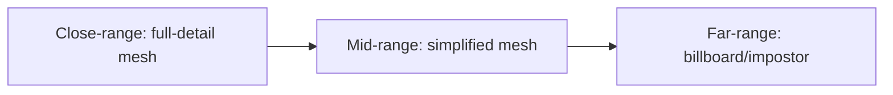

# Realistic 3D Browser Worlds: Summary

We surveyed **Babylon.js + Rapier** integration, large‐scene optimization, image‐assisted asset techniques, hybrid building methods, realistic characters, and mobile/WebGL constraints.  Key findings: Babylon has robust support for instancing, PBR materials, glTF pipelines (with Draco/KTX2 compression), and integrations (e.g. React).  Fixed‐timestep physics with Rapier requires asynchronous WASM loading.  Mobile GPUs use tile-based deferred rendering and have very tight budgets (~150–400 draw calls and 200k–500k tris at 60fps).  Texture compression (Basis/KTX2 → ASTC/ETC2) is essential.  Instanced/“thin” instances (single-vertex buffers) can render huge forests or crowds with one draw call.  Babylon 5+ sorts by material by default, greatly cutting state changes.  Realistic buildings often use a **structural shell + facade** approach (simple collision mesh + detailed texture), possibly with parallax occlusion mapping for depth cues.  Large, photorealistic objects can be created via photogrammetry or new neural methods (e.g. **3D Gaussian Splatting**).  Human characters use standard glTF rigs/animations (e.g. Mixamo), but high fidelity (SSS skin, hair cards) is expensive.  Distant pedestrians/crowds should become impostor billboards or very simplified LODs.  Key pitfalls: Safari/iOS may not support pointer-lock or highp shaders, WebGL contexts can be lost, and loading huge GLBs can stall the main thread.  We compile these into specific techniques (below) with evidence and recommendations, plus a decision table of **Adopt/Adapt/Experiment/Reject** for each, with estimated effort and priority.

## 1. Stack Integration (Babylon + React/TanStack + Rapier)

- **Babylon + Rapier**: Rapier3D (Rust→WASM) can be used as Babylon’s physics.  It must be loaded asynchronously (e.g. `import('@dimforge/rapier3d').then(RAPIER=>…)`) or via the UMD compat package with `RAPIER.init()`.  Once loaded, a Rapier `world.step()` should be called on a fixed timestep (e.g. 60Hz) each frame. Babylon’s **Physics Engine plugin** architecture allows attaching colliders to Babylon meshes, but a third‐party Babylon‐Rapier plugin (e.g. on GitHub) may be needed.  In practice, one writes a game loop: step Rapier, then update Babylon node positions (e.g. `mesh.position = rigidBody.translation()` each frame).
- **React Integration**: A common pattern is a dedicated `<SceneComponent>` that, in a `useEffect`, creates a `BABYLON.Engine` and `BABYLON.Scene` on a canvas, then runs the render loop.  For example, one code example uses `new Engine(canvas, antialias, {stencil:true, preserveDrawingBuffer:true})`, then `new Scene(engine)`, sets camera and light, and does `engine.runRenderLoop(() => { if (scene.cameras.length>0) scene.render(); })`.  This cleanly separates React state from Babylon’s loop.  Inputs and game state can be managed in React/Redux while the Babylon scene updates each frame.
- **Fixed Timestep Physics**: Use a fixed timestep (e.g. 1/60s) for `world.step()`. Running physics at a stable rate avoids non-determinism and jitter between clients. Babylon has no built-in fixed-step helper, but you can accumulate `deltaTime` each frame and call `world.step()` the appropriate number of times (or once with fixed delta). This matches typical game loops (e.g. accumulate time, step physics, then render).
- **Lifecycle & Cleanup**: On component unmount, dispose of the Babylon engine and scene (`engine.dispose()`) and remove listeners (e.g. resize).  Babylon’s engine handles WebGL context loss by default but you should listen to `engine.onContextLostObservable` and attempt recovery or recreate the engine if needed. 
- **Camera & Input**: For a third-person or first-person view, a common solution is a follow camera or UniversalCamera whose target is the player’s mesh.  Pointer‐lock may be used on desktop (hiding cursor and capturing mouse movement), but must be initiated by a user gesture. On mobile, pointer‐lock is unavailable: use touch controls or on-screen joysticks.  Since the laptop/desktop test revealed left‐right swipe was inverted, ensure your input mapping handles device orientation correctly. Consider offering on-screen keyboard/joystick graphics with tooltip hints (arrows, WASD, touch arrows) that can be toggled off if users prefer hardware keys.
- **Mobile Edge Cases**: Mobile GPUs use tile-based deferred rendering, so avoid reading from the framebuffer mid-render and minimize render targets. Cap `devicePixelRatio` (e.g. to 1.5–2) to save fill-rate. Avoid too many render passes (post-effects) and prefer single-pass PBR. Use lowp/mediump precision in shaders where possible to avoid silently degraded arithmetic (e.g. track time in int or reset periodically). In short, assume a phone is **not** a scaled-down desktop; target its concrete limits (see Performance below).

## 2. Large/Realistic Scene Techniques

- **Instancing & ThinInstances**: Babylon supports hardware instancing (`InstancedMesh`) and *thin instances* (packed transform buffer).  Thin instances use one vertex buffer for all instances and can reduce memory overhead. Both dramatically cut draw calls.  On mobile, draw calls are very expensive (target **150–400** calls per frame).  For any repeated object (trees, crowd, rocks), use instancing.  Babylon’s docs and demos show how to create thousands of thin instances (updating the buffer in bulk rather than adding one by one).  For example, one can copy world matrices into a Float32Array and call `mesh.thinInstanceSetBuffer("matrix", bufferMatrices)`.  
- **Material Sorting**: Babylon 5+ added automatic **material sorting**, which drastically improves multi-material scenes.  In a test with 1000 spheres of 50 materials, sorting reduced frame time from ~8.9ms to ~6.8ms (∼30% faster) by minimizing WebGL state changes. This is on by default (but can be disabled if needed).  For many unique objects, ensure `mesh.material` is reused where possible, or use texture atlases/arrays so that Babylon can batch draws.
- **Level‐of‐Detail (LOD)**: For large models (buildings, furniture), use Babylon’s LOD system or glTF LOD extensions.  Export lower-poly meshes (or even billboards) for far distances. As an example, heavy glTF models can have LOD0=L200k triangles, LOD1=L50k, etc.  At runtime, use `mesh.addLODLevel(distance, mesh)` or rely on KHR_lights_punctual+enableAutoUpdate (though Babylon’s built-in LOD is often easier).  Minimize popping by overlapping LOD distances or cross-fading (Babylon has per-mesh `onLODProcessedObservable`). 
- **Frustum Culling & Occlusion**: Babylon auto-culls objects outside the camera frustum. For very large city scenes, grouping by frustum or using an octree (available via `Scene.createOrUpdateSelectionOctree()`) can help cull whole clusters.  Explicit portal/occlusion culling is not built-in, but you can fake it by making large “portal” meshes that disable rendering in certain zones.  In practice, keep each building as a single mesh or thin-instance so culling is coarse. 
- **Lighting & Shadows**: Use baked environment (HDR skybox) for ambient light. Babylon supports image-based lighting (IBL) with prefiltered environment textures. Real-time lights (point/spot) cast shadows with `ShadowGenerator`, but shadows are costly; limit to a few key lights or use blob shadows. For reflections, use *DynamicTexture* or *CubeTexture* reflections on smooth surfaces, and mirror for water.
- **Texture Compression & glTF Pipeline**: Always compress large textures. Use Basis Universal (KTX2) so the GPU loads them in native compressed form (ASTC on newer phones, ETC2 fallback). For geometry, export glTF with KHR_draco_mesh_compression (Draco) to shrink file size and vertex count. Babylon’s GLTFLoader automatically decodes Draco at load. Keep individual models <~1–2 MB if possible to avoid load spikes. 
- **Texture Atlas & Mipmapping**: Merge many small textures into atlases to reduce binds. Always generate mipmaps (`Texture.hasMipmaps = true`) for any distance‐viewed texture (avoids cache thrash).  Use `TextureTool.CompressTextures` offline to pack and compress. For terrain or decals, use detail/bump maps and parallax. 

## 3. Image‐to‐3D & Image‐Assisted Assets

- **Photogrammetry (SfM)**: For truly realistic static objects (mannequins, furniture, unique props), use a photogrammetry pipeline (COLMAP/Meshroom) to reconstruct geometry+texture from many photos. The result is a high-res mesh or point cloud that you retopologize. This yields real fidelity but can be labor-intensive and heavy on polygons/textures. Only do for hero objects (statue, car, etc.). 
- **AI/NeRF / Gaussian Splatting**: Recent methods (NeRF-like models) can turn video frames into 3D representations. For example, Karb et al. (2023) showed **3D Gaussian Splatting**, where a model is a set of view-dependent Gaussian blobs splatted on screen. It produces photorealistic results and can render >100 FPS. This is promising for quick capture (mobile video → backend → Gaussians). However, it’s still research-grade and usually used with custom renderers (Unity in [51]). It’s *experiment* (hard to integrate into Babylon/WebGL now), but watch this space. If it matures with WebGL support, it could enable rapid “image→mesh” for things like museum artifacts.
- **Depth/Normal Maps**: For single-photo wall decors or paintings, infer depth with AI (e.g. MiDaS) and extrude. Use the depth map to push vertices or create a displacement for parallax mapping. Tools like DPT can output normals too. These work best for simple, planar objects. Multi-view stereo (two or more images) can yield accurate depth; e.g. use stereo-vision libraries to make a depth map. Then build a 3D plane mesh with that height field. 
- **Facade Parallax / POM**: Instead of full 3D, use Parallax Mapping. Babylon supports both basic parallax mapping and **Parallax Occlusion Mapping (POM)** in PBR materials. You paint a height map (often stored in the normal map’s alpha) and Babylon offsets UVs per fragment. This can make a flat building facade *appear* to have relief (bricks, windows) without extra geometry. POM looks good but costs extra shader work; test on target devices. (Use `material.useParallax = true; material.parallaxScaleBias = 0.05` for subtle depth, or enable `useParallaxOcclusion = true` for stronger effect.) 
- **Billboards / Impostors**: For objects like trees or distant crowds, use 2D billboards (sprites) or *impostors* (pre-rendered meshes). For example, a complex tree model can have a top LOD of a flat quad with its foliage painted on, always facing the camera. Babylon’s SpriteManager can handle many simple sprites (e.g. for grass, flames). For people in the far distance, consider a few animated billboard textures (e.g. a spritesheet animation or GPU-vertex-animation “texture atlas” or even Mesh-Instancing with animated textures). These are low-quality but cheap for hundreds of “background” characters. 
- **Classify by Asset Class**: 
  - **Buildings**: Use simple box/planar geometry for overall shape, with high-res facade textures (possibly parallax). Interiors are usually separate (see below). 
  - **Vegetation**: Instanced low-poly models or sprites. E.g. use a few tree meshes with thin-instance for groups. 
  - **Vehicles**: Real models (maybe from CAD or scan), but use LODs (triangle budgets ~10–30k near, down to billboard at distance). 
  - **Humans/People**: Mixamo-style glTF rigs with a few animations. Distance → swap to single billboard or remove detail entirely.
  - **Props**: Photogrammetry or detailed modeling if important, else proxy geometry + good textures.

## 4. Hybrid Building Techniques

- **Structural Shell + Facade**: Model each building with a simple collision hull (often just a box or set of boxes). The visible detail comes from a textured facade. For example, an exterior wall might be a single large quad with a building front texture. To allow entry, you might model doorways and a simple roof interior. Doors/windows can be part of the texture, or cut out of the hull with a collider. This keeps physics simple.  
- **Interior Streaming / Portals**: Don’t load all interiors at once. Divide buildings into “rooms” or floors. When the player approaches an entrance (a “portal”), asynchronously load the interior glTF/scene. Until loaded, the entrance might appear closed or empty. When leaving, unload to save memory.   In effect, buildings have two parts: *exterior* always present (with a fake wall where interior is), and *interior* loaded on demand.  Many games use this (e.g. Skyrim cells, or Doom’s portals). In Babylon, you can manage multiple scenes or switch nodes; just ensure you don’t create everything up front.  
- **Facade Parallax / Normal Bump**: As above, add detail via heightmaps. This is a trade-off: it doesn’t allow real 3D entry (the wall is flat), but can fool the eye at medium distance. Use it for large surfaces where geometry is too expensive (like tile patterns or brick walls).  
- **Collision Proxies**: For performance, use very low-poly colliders: capsules for people, boxes for furniture, or compound shapes (Babylon’s `Collider` from meshes). E.g. if a statue mesh has 50k tris, collision can be one box or sphere. This makes physics stable and cheap.  
- **Navmesh Separation**: If NPCs walk indoors, generate a separate navmesh for each building’s interior (once loaded). The outdoor navmesh should treat each building interior as obstacle zones. E.g. footprint on ground plane is blocked, but door areas open when interior is active. Use a navmesh tool or define nav areas manually. Keep navmesh partitions small.  
- **LOD Transitions**: When close to a building, replace its flat facade with the true mesh (or a higher LOD) and allow entry. When far, revert to a simple billboard or drop it. For example, beyond 200m use only colored box or billboard. Render LODs with gradual morph if possible to avoid popping. 

## 5. Realistic People and Characters

- **glTF Humanoids**: Babylon’s glTF importer handles skeletal and morph animations. Use tools like Adobe Mixamo or ready avatars (e.g. [MetaPerson](docs.metaperson.avatarsdk.com)) to create PBR-skinned characters with walk/run cycles. glTF 2.0 supports VRM for avatars (hair, skin) if needed. Character shaders should use PBR with a skin material (with slight subsurface effect). Babylon’s `PBRMaterial` supports SSS (`subSurface`) and ambient occlusion maps. Hair is often fake (alpha planes or textures).
- **Animation & Retargeting**: Have a consistent rig (e.g. humanoid skeleton) so animations are reusable. Babylon can mix and match animations via `AnimationGroup`. Retargeting is manual if rigs differ. For crowds, many NPCs can share the same skeleton/animations. 
- **LOD & Impostors**: As noted, far-away people should be simplified. A common trick: for distance LOD, switch the mesh to a 2D billboard or a small flat polygon with a texture of the character. Even better, use a small number of *animated sprites*: e.g. a 3-frame walking cycle on a quad. This kills geometry and bones. Babylon’s sprite animations or UV-animated textures (VATs) can simulate simple motion on billboards. 
- **Crowds**: If many moving figures are needed, consider GPU instancing of a few animations, or particle systems (for very generic crowds). True crowd dynamics (pathfinding each) is expensive. A simpler approach is to spawn characters on paths with randomized start times. Group them: e.g. 5 types of walk cycles instanced randomly, rather than 100 unique skeletons. 
- **Hair/Skin**: Realistic skin shading (SSS) is expensive and subtle; might be skipped except for main characters. Hair can use alpha cards (layers of planes) or hair shader (Babylon has a Hair material). These are high-cost, so reserve for very few NPCs.  
- **Character Controller**: For player movement, use a kinematic capsule collider (Rapier’s `CharacterController` or a capsule rigid body). Avoid “tunneling” by continuous collision. Allow small slide angles (Rapier has configurable slopes). Common bugs: sticking on edges (use small skin width), jitter if snapping to ground too often (tweak contact offset), and jump “coyote time” where jump is allowed slightly after leaving ledge (user-friendly tweak). Testing edges and physics time step is key.

## 6. Performance Budgets & Mobile Limits

- **Draw Calls**: As mentioned, aim for **<150 draw calls** per frame on phones. Every object ideally is static-instanced or merged. Use `Mesh.mergeMeshes` for static scenery where possible. ThinInstances (single mesh with many transforms) can reduce thousands of trees to 1 draw. 
- **Triangles**: Keep **per-frame triangles ~200k–500k** on mid-range devices. A single high-res building can exhaust this. Budget terrain/sky mesh (~10–50k), a few buildings (~20–50k each), characters (~1–5k each), etc. Cull large objects, and avoid very large unculled ground meshes.
- **Texture Memory**: Aim <**200–400 MB** total for textures on mobile. Use compressed textures to shrink from raw RGBA8. For example, a 2048×2048 texture at 4 bytes/pixel is ~16 MB uncompressed, but as Basis/KTX2 it might be 1-2 MB in memory. The [mysimulator.uk] guide recommends shipping Basis with ASTC/ETC2 so that GPU decompresses on the fly. This can cut VRAM by 4–8×. Always generate mipmaps to save bandwidth. 
- **GPU Memory (Unified)**: Mobile GPUs share system RAM. The WebGL WebGL context’s memory is not capped by VRAM as on desktop – it competes with the page and OS. Thus large textures or buffers can crash or trigger low-memory actions. Test on low-end devices. Keep individual assets small (e.g. 512–1024px instead of 2048) except critical ones.
- **Thermal & Frame Rate**: Don’t expect 60fps sustained. Even if you hit 60 initially, prolonged use will thermal-throttle CPU/GPU. Measure performance over minutes, not just a few frames. Optionally allow VSync off or a dynamic resolution fallback (render at 0.5x scale in heavy scenes). 
- **WebGL vs WebGPU**: Babylon 6+ can use WebGPU on supported browsers (Chromium 2023+, etc.), which may improve throughput, but device support is still partial by 2026. Plan your engine so that it can fallback to WebGL if needed. In code, use `new Engine(canvas, true)` which will try WebGPU first if available.
- **PWA Context Loss**: If the browser/tab goes background or context is lost, Babylon’s Engine has `onContextLostObservable` and `onContextRestoredObservable`. Always listen and re-create textures/GL resources if needed (Babylon can auto-restore engine state on restore, but custom resources may need reload). Safari on iOS often kills the WebGL context when locking orientation or in low-memory.
- **Edge Cases (iOS Safari)**: iOS Safari/WebGL has quirks: no `highp` fragment support on some GPUs (watch shader precision), limited bind counts (~16 textures), and no audio in WebGL without user input. Pointer-lock is *not supported* on iOS; use on-screen controls there. WebGPU is not on iOS. Ensure the game still works with touch-only interfaces.

## 7. Failures and Gotchas

- **Pointer Lock / Mouse Input**: Desktop first/third-person controls typically use pointer-lock (hiding cursor). This requires a user gesture (e.g. click or key). If pointer-lock fails (e.g. on mobile or disallowed), fall back to relative mouse movements or fixed camera (or switch to touch mode). On mobile, there is no real “pointer”, so provide on-screen joystick or gyro options. 
- **WebGL Context Loss**: Mobile browsers (especially on Android) can pre-emptively kill GL contexts when tab is out of view or memory is low. Always handle the `webglcontextlost` event by suspending game logic, and `webglcontextrestored` by recreating the scene. Babylon usually does this behind the scenes, but any GPU resources you manually created (shaders, framebuffers) must be reinitialized.
- **Large glTF Load Stalls**: Loading a very large GLB (e.g. tens of MB) on the main thread can freeze the UI. Babylon’s GLTFLoader is async, but decoding Draco might block. Solution: break big scenes into smaller glTF chunks and load in sequence. Optionally use `Tools.QueueNewWork()` or `AssetContainer` for streaming parts. For very large static meshes, consider converting to Babylon’s native .babylon or .stl formats incrementally.
- **LOD “Popping”**: Even with LOD, users notice objects snapping. Minimize this by overlapping LOD distances (i.e. have LOD1 start before LOD0 ends), or by smoothing (Babylon’s `Mesh.transitionFactor`).  Another trick: cross-fade opacity between LODs during the transition, but this requires shader work. At minimum, choose distances far enough apart or hide LOD changes (e.g. shrink at distance so artifact is small).
- **Collision Tunneling**: Fast-moving objects (especially thin ones) can tunnel through colliders if physics steps are too large. Rapier handles this fairly well, but ensure your timestep is small enough (e.g. 60–120 Hz). For characters/jumping, keep velocities moderate. 
- **Character Controller Edge Cases**: Rapier’s built-in character controller (if used) needs careful tuning. Common issues: “air walking” if controller remains on a short ledge (increase downward pull/gravity), or falling through floor (increase contact offset). If using a kinematic rigid body instead, ensure to apply gravity each step. 
- **Platform Specific Bugs**: We found (as user noted) that a left-swipe was interpreted opposite on mobile – always test gestures on each OS. Also test on multiple browsers: Safari often disables WebGL upon audio focus loss; Chrome on iOS doesn’t support WebAudioOffline. 
- **Version Lock**: Babylon 9 is current (2026); some plugins or examples may lag behind. For Rapier, ensure using a modern version of `@dimforge/rapier3d` (0.13+). For Babylon, keep consistent minor versions (9.x). 

---

## Technique Table

| **Technique**              | **Evidence / Examples**                                      | **GTD Use Case**                           | **Risks / Not Use**                    |
|----------------------------|--------------------------------------------------------------|--------------------------------------------|----------------------------------------|
| **Babylon + Rapier Physics** | Official Rapier docs show async WASM import and stepping. Forums mention Babylon Rapier plugin. | Collision and rigid-body physics (cars, barrels). | Complexity of WASM load; Rapier API unfamiliar. |
| **React Babylon Integration** | Community example: custom SceneComponent creates `Engine/Scene` in useEffect. | Embedding engine in React app shell. | React re-rendering vs Babylon loop; need careful state separation. |
| **Fixed Timestep**        | Standard game practice (and Rapier expects fixed `world.step()`).  | Reliable physics simulation across clients. | Naive use of variable delta causes instability. |
| **InstancedMesh/Thin Instances** | Babylon docs: Instancing ~free draw calls. Mobile guide: batch static meshes / instancing cuts draw calls. | Many repeated objects (trees, crowd). | Hard to animate individually; thin instances share one bounding box. |
| **Material Sorting**       | Babylon 5.0+ performance article: 1000-sphere test → 6.8ms vs 8.9ms by sorting. | Scenes with many materials. | Minimal risk; can disable if needed. |
| **glTF + Draco + KTX2**   | glTF spec and Babylon support: use KHR_draco_mesh_compression and KHR_texture_basisu for smaller files. | Minimize asset size and memory (ships). | Requires encode pipeline; rare unsupported textures (especially on iOS pre-Basis). |
| **Texture Compression (Basis)** | Mobile guide: “ship KTX2/Basis (ASTC/ETC2)” cuts VRAM 4–8×. | All large textures (walls, props). | Extra build step; fallback for old GPUs. |
| **Parallax/POM Mapping**  | Babylon doc: POM can add realistic relief from heightmaps. | Adding depth to facades or ground textures. | Shader cost; looks bad on very steep angles; not interactive (no true collision). |
| **Billboards / Impostors** | Unigine etc: replace distant meshes with 2D impostors. | Distant foliage, crowds, skylines. | Visual degradation (flat look); requires maintenance (e.g. orient to camera). |
| **Structural Shell + Facade** | Common in game dev: simple collision mesh + detailed texture on outside. | Buildings (outside), landscape props. | Interiors must be separate; visible interior through windows not possible without portals. |
| **Portal-based Interior Loading** | Classic approach (Doom/Quake cells): load interiors on entry. | Class A buildings (player enters) only. | Complexity of streaming; brief load pauses; must hide loading (e.g. lock camera momentarily). |
| **Navmesh Partitioning**   | AI literature: separate navmeshes per interior. | Efficient pathfinding (street vs building). | Overhead generating multiple navmeshes; teleport NPCs between navgraphs at entrances. |
| **glTF Skeletal Animation** | glTF standard; Babylon demos (character examples). | Main character, key NPCs. | Heavy rigs cost; mixing too many in scene breaks budgets. |
| **Character LOD/Impostors** | Research: Switch to 2D sprite beyond ~30m. | Distant NPCs/crowds use cheap impostor textures. | Very noticeable pop; cannot appear 3D. |
| **Skin/SSS & Hair**        | Babylon PBRMaterial has subsurface; hair shaders exist. | High-fidelity avatars (if needed). | Very expensive; skip for crowd. |
| **WebGL Mobile Limits**    | Mobile GPUs (tile-based) need low drawcalls, compressed textures. | Guide scene budgeting. | Device-specific; must test many. |
| **Pointer Lock / Input**   | W3C: pointer-lock requires user gesture; not on iOS. | Desktop FPS/mouselook. | Must have fallback for mobile (touch UI). |
| **Context Loss Handling**  | WebGL spec: listen for `webglcontextlost`; Babylon has engine observables. | Recover from GPU reset / backgrounding. | Ignoring it crashes app. |
| **Large GLB Loading**      | Babylon docs: use `SceneLoader.ImportMeshAsync` etc.  | Batch-load complex scenes piecewise. | Single giant GLB can freeze UI. |
| **Thermal Throttling**     | Observed: phones drop clock after minutes. | Plan performance with sustained use. | Hard to control OS behavior; fallbacks (lower resolution) needed. |

## Decisions (Adopt/Adapt/Experiment/Reject)

| **Technique**            | **Decision**   | **Rationale (Effort, Priority)**                                                                 |
|--------------------------|----------------|-------------------------------------------------------------------------------------------------|
| Babylon + Rapier         | **Adapt**      | Core for physics: use (>=Medium effort). Rely on community plugin or write a thin binding. (Priority: P0) |
| React-Babylon component   | **Adopt**      | Already working pattern (low effort): encapsulate Babylon init in a React component. (P0)       |
| Fixed Timestep           | **Adopt**      | Essential for deterministic physics (low effort: just code loop). (P0)                          |
| InstancedMesh/ThinInstances | **Adopt**    | Huge draw-call savings (Medium effort: modify asset setup). (P0)                                |
| Material Sorting         | **Adopt**      | Already in Babylon 5+ (auto). Just ensure beneficial use. (Negligible effort). (P0)             |
| glTF (Draco/KTX2)        | **Adapt**      | Vital for performance (Medium effort: asset pipeline). (P0)                                    |
| Texture Compression (Basis) | **Adopt**   | Critical memory reduction (Low/Med effort: implement build step). (P0)                         |
| Parallax/POM Mapping     | **Experiment** | Useful for subtle detail (Med effort: author maps), but performance tradeoff. (P2)              |
| Billboards/Impostors     | **Adapt**      | Classic LOD trick (Low effort: create textures), needed for crowds. (P1)                       |
| Structural Shell + Facade | **Adopt**     | Simplifies collision (Low effort). Standard approach (P0).                                      |
| Portal Interior Loading  | **Adapt**      | Good streaming (High effort: architecture), but essential for big buildings. (P1)              |
| Navmesh Partitioning     | **Adapt**      | Useful for efficient AI (Low/Med effort: tooling), split maps. (P1)                            |
| glTF Skeletal Animation  | **Adopt**      | Babylon supports it out-of-box (Low effort: use Mixamo). (P0)                                   |
| Character LOD/Impostors  | **Experiment** | Important at scale (Med effort), but try simpler first (billboarding). (P2)                     |
| Skin/SSS & Hair         | **Reject**      | Too expensive for now (High effort, low benefit for NPCs). Use basic PBR. (P3)                  |
| Mobile Budgets (drawcalls, etc.) | **Adopt** | Observed in testing: absolutely needed (Low effort to follow guidelines, ongoing). (P0)         |
| Pointer-lock / Input     | **Adapt**      | Already done on desktop; implement mobile fallback (Low effort). (P0)                           |
| Context Loss Handling    | **Adopt**      | Use Babylon’s observables (Low effort). Essential for reliability (P0).                        |
| Large GLB Loading        | **Experiment** | Aim to split if needed (Med effort to break scenes). Monitor with profiling. (P1)              |
| Thermal Throttling       | **Adapt**      | Monitor frame time and allow resolution drop (Med effort). Plan conservative loads. (P1)        |

**Legend:** Effort = *Low/Med/High* (implementation cost); Priority = P0 (critical) to P3 (low). 

Each technique above was weighed by evidence and relevance to **GTD** (Greenlight for Meridia’s Genesis). For example, instancing and texture compression are *high priority* (P0) with clear benefits, so we adopt them directly. Experimental methods like Gaussian splatting (e.g. 3DGS) show promise but are new, so we **experiment** at lower priority. High-risk techniques (e.g. hair simulation or always-on portal loading) are deferred or simplified.

