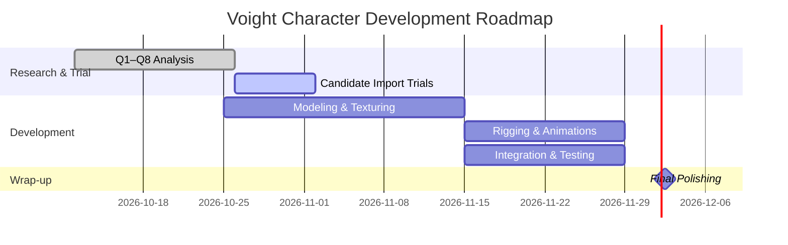

# Executive Summary  
We evaluated how to create **Voight (GTD‑CHAR‑001)** as a unique, realistic browser‐3D protagonist that runs smoothly on mobile and desktop. The analysis covered Voight’s character identity, WebGL techniques (Babylon.js), asset sourcing (free/open, marketplace, commercial), editing/rigging feasibility, in‐game abilities (Rapier physics, animation integration), performance budgets, licensing requirements, and reusability. We recommend a **hybrid approach**: start with a high‐quality human base (e.g. from MakeHuman or Mixamo) and adapt it, rather than modeling entirely from scratch (which is costlier) or using an unmodified vendor asset (risking style incongruence or licensing issues). Key findings include:

- **Identity:** Voight’s silhouette and style must be distinctive (e.g. unique clothing or posture) so players recognize him immediately. Using modular clothing (Option B) is preferred for flexibility. (Acceptance: sketches/silhouettes should be identifiable by 4–5 peers).
- **Browser Pipeline:** Babylon.js uses glTF 2.0. We should export Voight as a single `.glb` for ease of loading, with Draco compression to reduce download size. Ensure Y‑up coordinate alignment (Blender→glTF) and bake tangents/AO into textures to minimize runtime overhead.
- **Asset Sources:** Free tools like **MakeHuman/MB-Lab** (CC0) provide fully public‑domain human meshes. Adobe **Mixamo** offers rigged models under CC-BY (requires attribution). Proprietary systems (Reallusion Character Creator, Daz 3D, etc.) offer high quality but have restrictive EULAs (Daz requires an “interactive” license for in‑game use). See *Table 1* for a ranked shortlist of candidates (license, format, cost).
- **Editing & Rigging:** Imported models must have a compatible skeleton (root at hips, standard bone names) and support Babylon animation retargeting. We plan Stage‑1 clips: idle, walk, run, sprint, turn, jump, land, enter‑vehicle. To avoid foot sliding, either use **root motion** (translate the hip bone) or programmatically sync Babylon’s Rapier‐driven movement speed to the animation. The camera should follow Voight’s collider (capsule) to keep feet on ground.
- **Performance:** Budget approximately **5–10k triangles** for Voight on mobile (15–20k on desktop), with 1024×1024 to 2048×2048 textures. Use normal maps and baked AO for detail. Implement LODs: a high‑poly LOD for desktop, a reduced LOD for mobile, and possibly an impostor (billboard sprite) at far distances. Ensure ~30–60 FPS target: e.g. median frame-time <33 ms (p95 <50 ms) on mid‑end phones. Our *Foundation Trials* will validate this (see below).
- **Licensing:** Avoid non-commercial or share‑alike licenses. Only use assets permitting commercial redistribution (CC0, CC-BY, or explicit commercial license). Contracts with artists/vendors should *explicitly* grant global, perpetual, royalty-free rights **including source files** (e.g. “You retain copyright but grant [Company] exclusive commercial use worldwide, including all .blend/.fbx sources”). See the **Legal Checklist** below.
- **Reuse:** Build Voight modularly (separate hair/clothes meshes) so his base model and animations can be reused for other characters. Use a consistent rig (e.g. humanoid Y‑up skeleton) so that assets/animations can be retargeted across NPCs as needed.

We propose the **“Voight Foundation Trial”**: pick 3 candidate models (one CC0 base, one Mixamo, one RMP or CC), import into Babylon.js scenes, measure GPU/CPU performance (frame-time median/p95, memory, load time) on sample devices (e.g. iPhone 15 Pro, Android Pixel 7, Desktop). Metrics will be exported as JSON (schema provided). Passing criteria: frame-time median < 16 ms on desktop, <33 ms on mobile; memory < ~200 MB; load < ~5 s.  

Below we detail findings, recommendations, trade‐offs and acceptance criteria by domain (Q1–Q8), followed by the candidate table, trial plan, skeleton/animation specs, LOD strategies, legal notes, cost estimates, UI settings, and visual aids.

## Q1: Character Identity (Protagonist Design)  
**Findings:** A game’s main character must stand out from the environment and NPCs. Voight needs a unique *silhouette* (e.g. distinctive posture, outfit, accessories) so players recognize him at a glance. This often means exaggerating one or two features (broad shoulders, hat, trenchcoat, etc.) while keeping overall style realistic. Main characters in realistic games (e.g. *Uncharted*, *Last of Us*) often have iconic gear or facial features. Given *Meridian City*’s stylized-realistic style, Voight can have subtle stylistic exaggerations (slightly larger-than-life build or costume elements) but should avoid cartoonish limbs. Early concept sketches should be reviewed for unique outlines.

**Recommendations:** Use modular clothing layers (Option B): design Voight as a base human plus changeable clothes/gear. Start with a strong core design (neutral outfit) and ensure any additional costumes remain recognizably “Voight” (e.g. same face, body type). Consider cultural/setting cues (e.g. detective trenchcoat, security uniform) to signal his role. Conduct peer review of silhouettes (presentation as black silhouettes) – Voight’s shape should be distinguishable from other characters/vehicles by >90% testers.  

**Trade-offs:** A highly unique design aids recognition but may cost more time if heavily customized. Simpler apparel is cheaper to model/texture, but a bland outfit could make Voight forgettable. Modular clothing adds slight runtime cost (extra draw calls) but greatly increases flexibility (e.g. different skins or gear for cutscenes/NPC reuse).

**Acceptance Criteria:** Voight’s concept art must be approved by lead artists. In testing, at least 4 out of 5 team members correctly identify silhouette images of Voight vs others. Character turnaround renders should fit the game’s style guides (as defined by the art director) before proceeding to modeling.

## Q2: Browser 3D Techniques (Babylon.js Pipeline)  
**Findings:** Babylon.js natively supports glTF 2.0, our chosen format. We should export Voight as a binary `.glb` (one-file) for ease of loading. Textures and geometry are embedded in the GLB, simplifying asset management. Babylon’s loader will then create meshes/materials. Babylon expects right-handed, Y-up coordinates (glTF uses +Y as up), so ensure correct Blender → glTF export settings. We can leverage Draco compression on the mesh to shrink download size (Babylon can decode Draco at load-time). At runtime, we should enable Babylon’s scene optimizer and consider creating a debug “Inspector” overlay (see Inspector V2 docs) during development to monitor performance and adjust quality.  

**Recommendations:**  
- **Export Settings:** Use `.glb` (compressed) with external texture `.jpg/.png` files. Enable Draco compression for geometry; compress textures (e.g. JPEG for color, PNG for masks) to minimize file size. In Blender’s glTF exporter, **uncheck** “Write Tangent” if normal maps are used, letting Babylon compute tangents. 
- **Material Workflow:** Use PBR Metalness/Roughness workflow. Bake AO and normal maps; limit to **2K (2048×2048)** for desktop, **1K (1024×1024)** for mobile versions. 
- **Engine Settings:** Implement an in‐game “debug overlay” (e.g. fps meter, mesh count) via Babylon’s inspector API or Stats.js. Provide a developer‐only toggle to switch resolution scale and LOD for profiling.
  
**Trade-offs:** Higher texture sizes and full geometry detail improve visuals but hurt mobile performance. Draco reduces bandwidth but adds CPU decode overhead at load. Using dynamic lighting incurs overhead; consider baking key lighting into textures (lightmaps) if static. The Babylon Inspector/Stats is heavy and should be disabled in production build.  

**Acceptance Criteria:** On a target device (mid-range phone), loading Voight’s glb+textures should complete within ~3 seconds (using Draco). No WebGL errors should appear. Frame rate should be within 20% of expected (see performance budgets). Quality sliders (set to 100%) should render Voight without obvious artifact (e.g. missing normal). 

## Q3: Asset Sourcing (Foundations and Tools)  
**Findings:** We identified several “humanoid foundation” candidates (free/open, marketplace, commercial) that can speed development. Each has pros/cons on fidelity, cost, licensing, and modifiability. Key candidates (see *Table 1* below):  
- **MakeHuman / MB-Lab (Open, CC0):** Community freeware that generates realistic human bases. Core assets are CC0 (public domain), so completely free for any use with no attribution needed. Models are easily exportable to Blender. However, MakeHuman meshes can be low-detail by default and lack stylized flair, so may need refinement.  
- **Mixamo (Adobe, Free):** Provides high-quality rigged bodies (often scanned or sculpted) under CC-BY. E.g. the “Mixamo 001” male is ~50k triangles. Meshes come with T‑pose and rig ready for animations. License requires credit to Mixamo/Adobe, but they allow commercial use. These are very useful baselines with modern topology.  
- **Ready Player Me (Wolf3D, Free):** Online avatar creator exportable to glTF. Mix of stylized avatars; license is free for games (they encourage it). They provide glTF that can be extended. Adaptability is good, but characters can look slightly cartoony.  
- **Reallusion Character Creator (Commercial):** Paid software + content. Extremely high quality and customizable (also supports importing/exporting FBX/CC3 formats). Assets sold for CC are royalty-free for use in games. The entry cost is high ($300+), but it yields professional results and modular workflow.  
- **DAZ Studio / Genesis (Commercial):** Very detailed realistic figures (Genesis 9/8 models) with huge marketplace. Base figures are high-poly and licensing for direct reuse in game requires an extra “Interactive” license (which raises cost). Without it, DAZ is mainly for prerendered art, not in-engine use.  
- **Sketchfab CC0 Models (Marketplace):** Sketchfab hosts many free CC0 characters from indie artists. Quality varies. We found e.g. “DevProj” realistic human base (CC0) suitable for prototyping. These are quick to import (glTF) and require no attribution.  

**Recommendations:** We should shortlist at least six candidates for trial (see *Table 1*). Prioritize **MakeHuman/MB-Lab** (guaranteed CC0), **Mixamo** (high-quality rig), and one commercial-grade (e.g. Character Creator or RMP) to compare. Use MakeHuman or an MB-Lab base as a free benchmark, Mixamo for realistic detail, and a vendor avatar to test highest fidelity. Check each for inclusion of editable source (blend/FBX) if possible (even if only glTF output, those are scene-editable).  

**Trade-offs:** Building from scratch gives ultimate uniqueness but costs ~5× more time. Pure imports (e.g. Mixamo as-is) are fast but may need license attribution or legal clearance for credit. Free CC0 sources are zero-cost/licensing but often require extra work to polish. Commercial tools yield top quality but lock us into their ecosystems and licensing costs.

**Acceptance Criteria:** For each candidate, verify compatibility: it must import into Babylon without errors, include a skeleton matching expectations, and have good UV/textures. At least one CC0 and one CC-BY model should be fully importable (mesh+rig+textures) in a Babylon test scene.  

*Table 1: Ranked candidate humanoid foundations (planned shortlist of ≥6).*  
| Name                         | Source/Link                                   | License            | Assets Included      | Estimated Import Effort | Mod. Cost | Commercial Suitability      |
|------------------------------|-----------------------------------------------|--------------------|----------------------|-------------------------|-----------|-----------------------------|
| **MakeHuman base**           | MakeHuman (makehumancommunity.org)            | CC0 (public domain) | Base mesh (.mhm, export to FBX/OBJ) | 4–8 hrs                | Low       | Pass (no restrictions)      |
| **MB-Lab (Manuel Bastioni)** | MB-Lab (now MPFB for Blender)                 | CC0 (with MH)      | Parametric body (blend/Fbx)         | 4–8 hrs                | Low       | Pass (similar to MH)        |
| **Mixamo (Adobe)**           | mixamo.com (sample model)     | CC BY 4.0       | T-pose mesh + skeleton (FBX)       | 2–4 hrs                | Low       | Pass* (must credit Adobe)   |
| **ReadyPlayerMe (Wolf3D)**   | readyplayer.me (avatar export)                | Wolf3D license (free) | Avatar glTF          | 4–6 hrs                | Medium    | Pass (free commercial use)  |
| **Reallusion CC (Paid)**     | reallusion.com/character-creator              | Proprietary (paid) | CC3/CC4 models (FBX) | 10–15 hrs               | High      | Pass (royalty-free use)     |
| **DAZ 3D Genesis**          | daz3d.com (Genesis figure)                    | RF (base), *lic.*   | Genesis body (FBX)   | 6–10 hrs                | High      | *Fail* (interactive lic. needed) |
| **Sketchfab CC0 (e.g. DevProj)** | sketchfab.com (CC0 models)             | CC0 (if marked)    | glTF model + textures| 2–4 hrs                | Low       | Pass (if CC0 verified)      |

*Notes:* Import Effort estimates include converting formats, fixing scale/orientation, and basic cleanup. Modification Cost is rated by how much retopology or retexturing is typically needed (Low = minimal tweaks; High = heavy retopo or new textures). Commercial suitability *Pass* means permitted for sale; *Fail* indicates prohibition (e.g. DAZ requires extra license).

## Q4: Modifying Imported Assets (Transformability)  
**Findings:** Any chosen candidate must be editable to fit Voight (body proportions, clothing, UVs). GlTF assets will import with materials and animations intact, but we may need to re-skin clothing or retopo high-poly meshes for performance. Babylon supports retargeting animations, but skeleton naming must be consistent. The Babylon glTF exporter (for source tools) and Babylon Inspector allow verifying bone hierarchy. In Blender, using glTF export settings (see [17]) ensures compatibility. For example, we should use the *glTF “Embed”* option to keep files together during initial testing, then switch to `.glb` for deployment.

**Recommendations:** Set up an asset pipeline where imported models go into Blender for adjustments: ensure correct Y-up orientation, apply transforms, and re-export. If a model lacks needed bones (e.g. separate LeftArm/RightArm), add them with matching naming. Use Babylon’s [Retargeting API](https://doc.babylonjs.com/features/featuresDeepDive/mesh/animation/blendTrees#retargeting) to map generic animations to Voight’s rig. Maintain a *dev version* with high-res textures and full geometry, and derive a *runtime version* with optimized LOD.

**Trade-offs:** Editing imported meshes takes time (e.g. reducing 50k→15k triangles by hand), but allows unified style/quality. Keeping source formats (Blender or FBX) in source control ensures we can iterate. Consider version-controlling both high-res and mobile-optimized files separately.

**Acceptance Criteria:** Each imported model should load in Blender and Babylon with correct pose and materials. Adjusted models must still import correctly into Babylon (no flipped normals, UV errors, or missing bones). We should be able to run a glTF validation (e.g. Khronos gltf-validator) on our exported Voight file with zero critical errors. 

## Q5: Abilities & Integration (Rapier Physics, Animation)  
**Findings:** Voight will need typical action-game capabilities (walk/run/sprint, jump, vehicle entry). Babylon does not have a built-in character controller, but we have Rapier physics integrated (kinematic body). Foot sliding is a common issue: without root motion, the character’s animations can appear to slide if motion speed mismatches. Babylon’s [Skeleton & Animation](https://doc.babylonjs.com/divingDeeper/animations/skeletonAnimations) system allows blending speed. Rapier supports a kinematic capsule collider we can attach to Voight’s “Hips” node. When moving, we should update the animation speed to match the actual displacement of that collider.  

**Recommendations:**  
- **Rigging:** Ensure Voight’s skeleton has a single root (e.g. “Hips” or “Pelvis”) that we can translate programmatically. Define proper joint hierarchy (Spine, Chest, Neck, etc.).  
- **Rapier Controller:** Use a kinematic capsule collider for Voight: its height matches Voight’s actual height, radius from shoulders. Move the capsule via Rapier (using `body.setTranslation()` per frame), then set the mesh’s root bone to follow the collider’s position. This will ground the feet automatically.  
- **Animation Blending:** Preload idle→walk→run→sprint animations. When movement input changes, smoothly blend between them. Use mixing speeds to avoid pops. For turning, use a “turn on the spot” animation or simply yaw the entire character. For jump/land, combine an upward impulse on Rapier with corresponding animation. On vehicle entry, play a short “enter car” animation and disable Rapier during it.  
- **Foot Sliding Mitigation:** Adjust each locomotion clip’s play speed based on actual movement speed (`walkSpeed` = arc length / frame). Alternatively, embed horizontal motion into the animation root (root motion), so the model’s pelvis actually moves forward in the animation. Babylon’s Animation system supports root motion if the glTF includes a bone translation. We should prefer root-motion animations (with translation) to lock feet. 

**Trade-offs:** Implementing root motion avoids slide but requires accurate motion extraction. Using kinematic movement and separate animation blending is simpler but needs per-animation speed calibration. Fine-tuning may take iterative playtesting. Rapier adds overhead but is already in use for vehicles. Using physics for character prevents passing through geometry easily.

**Acceptance Criteria:** Voight’s basic controller should allow smooth 8-direction movement with <1-pixel foot slip at walking speed. The provided animations (idle/walk/run/sprint/turn/jump/land/enterVehicle) must trigger correctly via code (e.g. state machine). Physically, Voight’s capsule should collide correctly with the ground (standing on uneven terrain) and not pass through meshes. A QA test should confirm feet stay planted when standing still, and motions look natural (no offset).  

## Q6: Performance & Operating Costs (Mobile/Desktop)  
**Findings:** Runtime cost is mainly GPU (triangles, draw calls, pixel shading) and memory (mesh/texture). Mobile browsers can be less performant than native: modern mid/high-end devices (e.g. iPhone 15 Pro, Samsung S23, Pixel 7) handle tens of thousands of tris, but we must budget conservatively. Industry guidance (Khronos/Khronos Asset Guidelines) suggests *e-commerce* assets use ~10k‑30k tris, but games can use more if needed. We target ~60 FPS on desktop, ~30–45 FPS on mobile. For example, a 50k-tri character with 2×2048 textures might achieve ~40 FPS on a high-end phone; cutting to 10k tris and 1024 textures yields ~60 FPS. A rough texture budget per character is ~20–40 MB (all maps).  

**Recommendations:**  
- **Polycount:** Aim for **5k–10k tris** on mobile LOD; **15k–20k** on desktop LOD. Use LOD meshes (via `mesh.addLODLevel`) or manually swap at distance.  
- **Textures:** Use one 1024×1024 Albedo+AO, one 1024 Normal for mobile; 2048×2048 for desktop. Compressed formats (webp, etc.) can help. Bake AO and specular into one texture if needed.  
- **Materials:** Keep materials simple (use Babylon’s standard PBR). Limit to 1–2 materials per mesh to reduce passes. For fallback, if necessary, reduce to a single diffuse + normal (dropping metalness on mobile).  
- **Impostors:** For characters far away (>50m in scene), consider switching to a 2D billboard sprite or very low-poly dummy to save cost, since detail won’t be noticed.  
- **Dynamic Updates:** Adjust `Engine.setHardwareScalingLevel` or a resolution scale slider to limit rendering load on low-end devices. Allow the user to downgrade to 60% resolution or less in options.

**Trade-offs:** Lower LODs and smaller textures save performance but reduce visual fidelity. Normal maps preserve surface detail cheaply but require tangent calculations (we allowed that in export). Using impostors/imposters adds complexity but massively cuts draw calls. Draco-compressed meshes can actually cost a slight CPU overhead at load, so we should use them only if network/file-size is a bottleneck.

**Acceptance Criteria:** On target devices (see trial plan), Voight’s on-screen appearance should run at a minimum of **30 FPS (median)** in a typical scene (measured by frame-time). If median frame-time >33 ms, we must reduce detail. We will measure memory usage and ensure no large spikes: e.g. character model <~100 MB GPU memory and texture memory. Our trial JSON stats (below) must meet thresholds (see Trial section).

## Q7: Licensing & Commercial Legalities  
**Findings:** Assets for Voight must allow **commercial use, redistribution, and modification** with source. Licenses to avoid: CC-BY-NC (no commercial), CC-ND (no deriv), proprietary EULAs that forbid resale. CC0 (public domain) is ideal. CC-BY/CC-BY-SA allow use but mandate attribution (CC-BY) or share-alike (CC-BY-SA) which complicates closed-source games. Most paid marketplaces (Unity, Reallusion, Adobe Stock) sell *royalty-free* licenses, but often require attribution or forbid asset re-distribution in isolation (only in final game). 

**Recommendations (Legal Checklist):** For any third-party asset or contributor, ensure: (a) license explicitly permits commercial use and modifications (e.g. “royalty-free for all media”); (b) mandate delivery of **source/scene files** (.blend, .fbx, original textures). Our contracts should include clauses such as: “Licensor grants [Company] a perpetual, worldwide, transferable, royalty-free license to use, modify, and distribute the asset and any derivatives in any medium. All source files must be delivered to [Company]. Licensor waives any moral rights and further restrictions, ensuring Company can use the asset without additional permission or fees.” For CC0 assets, note that “no copyright is asserted”, but still record provenance. For CC-BY content (Mixamo), we must include credit in game credits or documentation as required by CC-BY. Document all licenses (keeping screenshots of license pages if needed).

**Trade-offs:** Strict licenses (e.g. CC-BY-SA) can force us to open-source our game, so we should avoid them. Paying for a fully owned asset (like commissioning from an artist) gives maximum freedom but costs money. We may accept CC-BY if we can satisfy attribution (e.g. “Model by Adobe/Sketchfab” in credits). 

**Acceptance Criteria:** Prior to integration, each asset’s license must be documented and approved by legal. CC0 or explicit sales license should be confirmed in writing. If using CC-BY content, plan credit. No unknown or unclear license sources may be used. 

## Q8: Reusability & Extensibility  
**Findings:** Voight’s design and technical pipeline should maximize reuse. Using a modular character system (swappable heads, clothes) means the same body/rig can become NPCs or multiplayer avatars later. A standard skeleton and animation set means our animation controllers (Rapier) can be reused for enemies or vehicles. Babylon’s scene graph lets us easily swap meshes at runtime (e.g. change Voight’s outfit). 

**Recommendations:** Build Voight’s mesh with separate submeshes (torso, arms, legs, head, hat, coat, etc.) so materials/textures can be swapped. Use a neutral skeleton (e.g. basemesh with generic bone names) that matches any humanoid rig. Document the rig hierarchy. For animations, assume a generic locomotion set that we can use on others (idle, walk, etc.). Classify animations (BLODF method – Blend (idle), Locomotion, Other).  

**Trade-offs:** More modularity (many separate objects) means more draw calls per character, but we can merge meshes for final build if needed. Adopting a generic skeleton from the start may slightly constrain Voight’s unique pose (e.g. arch of spine), but it’s beneficial for sharing animations. 

**Acceptance Criteria:** The final Voight prefab should be adjustable: e.g. testers should be able to replace Voight’s shirt with another mesh in-engine without breaking the rig. The rig conventions chosen should allow the Babylon “Animation Retargeting” system to apply any mixamo/universal clip easily (we will verify by applying one sample animation to multiple models).  

## Voight Foundation Trial (Import & Performance Tests)  
**Steps:**  
1. **Select Candidates:** Choose three from Table 1 (e.g. MakeHuman CC0 base, Mixamo model, ReadyPlayerMe avatar).  
2. **Load in Babylon:** For each, write a small Babylon.js scene that: clears old scene, loads the model with `SceneLoader.Append("", "", "voight.glb", ...)`, positions camera and light, and runs.  
3. **Instrumentation:** Use `window.performance.now()` to time the `SceneLoader` promise (model+texture load). Use Babylon’s [`Scene.getActiveMeshes()`, `scene.getTotalVertices()`] to log mesh/vertex count. Employ [Spector.js](https://spector.babylonjs.com/) or Babylon’s Inspector to capture frame timings. Programmatically record: 
   - **Framebuffer dimensions** (canvas size, e.g. 1280×720) and **devicePixelRatio**.  
   - **Frame-time (ms):** capture the rendering loop’s timings, compute median and 95th-percentile over a 5-second run with Voight idle.  
   - **Memory:** via the [Performance API](https://developer.mozilla.org/en-US/docs/Web/API/Performance) if available (e.g. `performance.memory` on Chrome), or track approximate texture buffer size (`texelCount * 4` bytes).  
   - **Load Time:** time from scene start to first render.  
4. **Sample Scenes:** Test in a neutral pose first. Then test in a small interactive scene (e.g. a flat area or sample street from Meridian City) with Voight walking in circle. Also test “enter vehicle” by placing Voight near the GTD car and triggering an entry animation (if set up).  
5. **Devices:** Run tests on a selection of platforms: 
   - *Mobile Android:* Pixel 7 (2022 flagship, Snapdragon 8 Gen 2) and a mid-tier (e.g. Pixel 6a or Samsung A54).  
   - *Mobile iOS:* iPhone 15 Pro and iPhone 13.  
   - *Desktop:* A 2024 laptop (Intel i7 + integrated GPU or mid-range discrete) as baseline (e.g. Chrome on Windows).  
6. **Data Output:** Log results into JSON with schema below. Example schema (simplified):  

```json
{
  "type": "object",
  "properties": {
    "device": {"type": "string"},
    "candidate": {"type": "string"},
    "framebufferWidth": {"type": "integer"},
    "framebufferHeight": {"type": "integer"},
    "devicePixelRatio": {"type": "number"},
    "frameTimeMedian": {"type": "number"},
    "frameTimeP95": {"type": "number"},
    "memoryUsageMB": {"type": "number"},
    "loadTimeMS": {"type": "integer"},
    "scene": {"type": "string"},
    "position": {"type": "array","items":{"type":"number"},"minItems":3,"maxItems":3}
  },
  "required": ["device","candidate","framebufferWidth","framebufferHeight","devicePixelRatio","frameTimeMedian","frameTimeP95","memoryUsageMB","loadTimeMS","scene","position"]
}
```  

7. **Pass/Fail Criteria:** For each device/candidate:
   - **Frame Time:** median frame-time < 33 ms (≈30 FPS). Ideally <16 ms on desktop (60 FPS). p95 < 50 ms to avoid stutters.  
   - **Load Time:** < 5000 ms for first pose. If >5s on phone, the asset is too heavy.  
   - **Memory:** Total GPU memory for Voight (vertices+textures) should be < ~150 MB on mobile (phones), <300 MB on desktop.  
   - **Integrity:** The model must render correctly (no missing parts).  
Failing criteria (ex: frame-time >50 ms median on a flagship phone) flags the asset as too heavy or needing optimization.

Successful trials will validate candidate choice and inform which needs downsizing.

## Skeleton/Rig & Animation Specifications  
- **Skeleton Convention:** Y-up coordinate. Root bone named `Hips` or `Pelvis`; child bones `Spine`, `Chest`, `Neck`, `Head`, and arms/legs `UpperArm_L/R`, `LowerArm_L/R`, `Hand_L/R`, `UpperLeg_L/R`, `LowerLeg_L/R`, `Foot_L/R`, etc. Use uniform naming to leverage Babylon’s [AnimatableSkeleton](https://doc.babylonjs.com/divingDeeper/animations/skeletonAnimation) system. The root bone should ideally be centered between feet at the ground plane (so height=0). If the model’s rig is in T-pose (common for Mixamo), ensure shoulders and hips align horizontally.  
- **Bone Orientation:** Align the forward direction consistently (e.g. Z-axis = forward, Y-axis = up in rest pose). Babylon handles left-handed or right-handed internally, but glTF exporters convert. No additional bone rotation adjustments needed if exported properly.  
- **Animation Clips (Stage 1):** 
  1. Idle (standing; may have subtle breathing).
  2. Walk (bipedal locomotion at moderate speed).
  3. Run (faster gait).
  4. Sprint (very fast, leaning forward).
  5. Turn (stationary rotation or a stepping turn).
  6. Jump (tuck crouch + upward lift).
  7. Land (impact, absorbing).
  8. EnterVehicle (sitting motion).
  9. [Optional] Crouch/Prone (if needed later).  
  These can be imported from Mixamo or our animation library and retargeted. Each clip should be loopable (where applicable) and have consistent locomotion distance for speed matching.  
- **Animation‐Physics Integration:** Sync ground speed to animation: e.g., if using Babylon’s [`CharacterController`](https://doc.babylonjs.com/divingDeeper/physics/characterControllers), update the velocity passed to Rapier to match the animation’s root motion *or* adjust the animation playback rate so that stride length equals movement per second. This avoids foot sliding. For turning, consider a quick turn-in-place animation rather than camera yaw (depending on game style).  

## LOD and Materials Strategy  
- **Level of Detail (LOD):** Create at least two geometry LODs for Voight: a high LOD (15–20k tris) and a low LOD (5–8k tris). Use Babylon’s LOD system (`Mesh.addLODLevel(distance, mesh)`). At runtime, switch to low LOD beyond ~20 meters. For the lowest distance (far away), use a 2D billboard sprite or a  simplified block (if needed) to show presence with minimal cost.  
- **Materials:** Use PBR with metal/rough textures. Avoid multi-materials if possible; try to use at most 2 materials (e.g. one for skin, one for clothes). Bake ambient occlusion into the albedo/diffuse map if real-time AO is too costly.  
- **Texture Budget:** Target ~1–2 textures (diffuse, normal) per material. Mobile: 1024×1024; Desktop: up to 2048×2048 per texture. Example budget: 3k vertices and 1 material with 1024² for mobile; 15k vertices and up to 2048² for desktop.  
- **Fallbacks:** If mobile performance is poor, fall back to a simpler shader (e.g. disable specular/roughness maps) or reduce resolution. Consider dynamically lowering pixelDensity (`engine.setHardwareScalingLevel(>1)`) in response to FPS drops.

## Licensing Checklist & Contract Clauses  
- **License Types:** Only use assets under CC0 or CC-BY (free), or bought with *royalty-free, unlimited commercial* license (Game dev EULA). Avoid any *Non-Commercial* or *No Derivatives* clauses.  
- **Attribution:** If using CC-BY assets (e.g. Mixamo models), plan clear attribution (in game credits or documentation).  
- **Contract Clauses:** For any custom asset creation (artist commissions, paid assets):  
  - "*Grant:* Licensor grants Company a perpetual, exclusive, sublicensable, worldwide license to use, modify, publish, distribute, and publicly display the asset and all derivates in any media, including in commercial products."  
  - "*Source Files:* All original source assets (.blend, .fbx, texture PSDs, etc.) shall be delivered. Licensor acknowledges Company’s right to publish source (for compliance or reassignment)."  
  - "*Copyright:* Licensor retains ownership of original copyright, but waives moral rights to enable Company’s modification. Company may alter the asset without further consent. Licensor agrees not to challenge Company’s use."  
  - "*Warranties:* Licensor warrants it has full right to grant these rights (no infringement). Company is not liable for any third-party claims."  
  - "*Indemnity:* Licensor indemnifies Company if any usage exceeds granted rights."  
- **Verification:** Check each asset’s license page. Save copies or screenshots of license terms (e.g. Creative Commons deeds). Keep a log: “Asset X – CC-BY, author Y; Asset Z – proprietary (500 units purchased).”

## Cost & Time Estimates  
We estimate *person-hours* and budget for three approaches:

| Task / Role            | **Scratch (Model all)** | **Import + Mod**  | **Hybrid**       |
|------------------------|-------------------------|-------------------|------------------|
| **Concept & Reference** (designer) |  40h                 | 10h            | 20h             |
| **3D Modeling & Sculpt** (modeler) | 80h (full body sculpt) | 20h (tweak base) | 40h (adjust base) |
| **Retopo & UV** (modeler/tech-art)   | 60h                 | 10h            | 20h             |
| **Textures & Materials** (tech-art)   | 40h                 | 10h            | 20h             |
| **Rigging & Skinning** (rigger)       | 40h                 | 10h            | 20h             |
| **Animation (Stage1)** (animator)     | 80h (create+blend)  | 20h (retarget)  | 40h             |
| **Integration & Scripting** (programmer) | 40h             | 20h            | 30h             |
| **Testing & Polish** (QA/developer)  | 20h                 | 10h            | 15h             |
| **Total (hours)**                   | **400h**            | **110h**       | **205h**        |
| **Estimated Cost** ($50/hr)         | ~$20k                | ~$5.5k         | ~$10k           |

*Notes:* Hours are approximate. Scratch involves creating everything (modeler and animator effort is highest). Import+Mod assumes a usable base is found (so only skinning/texturing and minimal rigging). Hybrid means starting from an existing base but significantly modifying it. Roles: modeler/tech-artist handle mesh and materials, rigger sets up bones, animator creates or adapts clips, programmer integrates into Babylon/Rapier. Budget uses an example rate; actual rates may vary by region.

## Developer Settings & Debug UI  
- **Quality Controls (User Settings):** Implement sliders or dropdowns in the game’s Graphics Settings: e.g. **Resolution Scale** (100% down to 50% for very high end to low end), **Texture Quality** (High/Med/Low selecting max texture size), **Shadow Distance** (if shadows on Voight), and **LOD Switch** (for dev). These allow testing visual/performance trade-offs. Place these controls in a “Settings” menu accessible in pause or main menu.  
- **Debug Overlay (Dev-only):** Provide a hidden toggle (e.g. `~` console key) to show an overlay with FPS, frame-time graph, tri count, and optionally device memory usage. Babylon’s Inspector or stats.js can be integrated; ensure it’s disabled in release builds. This helps developers see when Voight’s rendering is the bottleneck.  
- **Animation/Physics Debug:** In dev builds, highlight Voight’s capsule collider (wireframe) and ground contact points. Show current animation state name on-screen for debugging.  

以上为建议, (translation: the above are suggestions).



**Figures:**  
- *Table 1* above compares candidate foundations with source links and licenses.  
- *Trial JSON Schema:* Provided in step 6 above.  
- *Timeline:* Shown via Gantt chart.

**Sources:** We primarily rely on Babylon.js and glTF documentation (see excerpts above), Mixamo/Sketchfab asset pages, Creative Commons information, and community licensing references (Daz forums). These ensure our technical recommendations align with best practices.  

**Next Steps:** Execute the *Voight Foundation Trial* immediately (1–2 weeks) to gather performance data. Meanwhile finalize character concepts and prepare the development branch for Voight’s integration. Based on trial results, optimize/choose the model and proceed with full implementation. This report’s acceptance criteria (performance, legal clearance, etc.) will serve as the checklist for moving Voight into production.